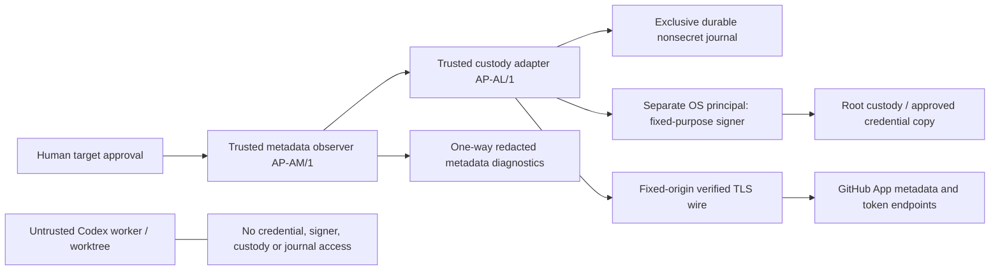

# AP-AL/1 — bounded GitHub App adapter (MVP.8d)

Issue #76 implements inactive, real-request-capable wire/custody components for
AP-AM/1. Development and CI use fake sockets/TLS, a fake signer and fake tokens
only. There is no enabled entrypoint, runtime integration, signer implementation,
key loader, service, default address/provider, credential CLI or deployment.
Source-only work does not require VM backups or privileged host changes.

## Trust boundaries



This is a recommended future separation, **not an implemented or audited IPC/OS
boundary**. Current Python objects run together only in offline tests. Trusted
operator pins remain external to Issue/model/source JSON; no organizational App
ID or default target is embedded. A future publisher is separate and unimplemented.
AP-SM/2 source delivery/review delegation grants no downstream credential or
publishing authority. App registration, JWT custody claims, API metadata, public
Bot profile and verified App-attributed action remain different claims.

## Construction and fixed operations

`app_api_wire.Wire` requires an explicitly supplied public **numeric IP** for the
fixed API origin. No DNS resolution occurs: unbounded libc resolver work would
otherwise defeat the socket deadline. A future trusted operator must independently
resolve/approve and refresh that address; stale/invalid routing fails closed.
This is not an alternative HTTP origin. Host, SNI and certificate hostname remain
`api.github.com`, port 443; private/link-local/multicast and scoped addresses fail.

The wire constructs a TLS client context with certificate/hostname checks and
TLS >=1.2. It loads only the fixed Debian system CA bundle, never an arbitrary CA
path, supplied context or SSL_CERT_FILE/DIR override. Every connect, handshake,
send and receive uses remaining monotonic deadline, <=5 seconds for the complete
exchange. The streaming reader rechecks deadlines per receive, preventing header
or body trickling from resetting the total limit. No proxy/environment proxy,
redirect, retry, external URL, credential-in-URL or user-selected method/query.

| Operation | Fixed path | Credential | Expected status |
| --- | --- | --- | --- |
| GET | `/app` | App JWT | 200 |
| GET | `/app/installations/{pinned id}` | App JWT | 200 |
| GET | `/installation/repositories?per_page=100` | Installation token | 200 |
| GET | `/users/{escaped pinned Bot login}` | **None** | 200 |
| POST | `/app/installations/{pinned id}/access_tokens` | App JWT | 201 |
| DELETE | `/installation/token` | The corresponding installation token | 204 |

POST body is exactly `{}`: no repositories/repository_ids/permissions restrictions
that could hide installation scope. There are no repository write routes, generic
HTTP methods or arbitrary payloads. Token lifecycle is deliberately **not called
GET-only**. API version is fixed at 2022-11-28. Link/pagination, redirects, compressed
content, duplicate/conflicting Content-Length/Transfer-Encoding, truncation,
oversize or unknown HTTP status block. Content-Length, chunked and close-delimited
responses are bounded to 64 KiB decoded content, 16 KiB parsed headers and 96 KiB
total HTTP framing. HTTP exceptions/bodies are not diagnostic text.

AP-AM response origin/TLS flags are synthesized after this wire succeeds, not
copied from response headers. Injected test wires provide no cryptographic
attestation. A future trusted entrypoint must wire the reviewed implementation,
not accept a transport factory, CA override or source flag from target content.

GitHub documents [installation authentication](https://docs.github.com/en/apps/creating-github-apps/authenticating-with-a-github-app/authenticating-as-a-github-app-installation),
[token issuance](https://docs.github.com/en/rest/apps/apps#create-an-installation-access-token-for-an-app)
and [token revocation](https://docs.github.com/en/rest/apps/installations#revoke-an-installation-access-token).
Those endpoints do not turn a Bot profile into performed_via_github_app evidence.

## Signer, leases and exact cleanup

`app_api_adapter.Adapter` implements AP-AM/1 Custody/Transport using explicit pins,
source correlation, signer, wire, complete journal and clock. A signer accepts only
validated `Claims` (App ID and short-lived iat/exp), never an arbitrary payload,
algorithm or path. Each pass requests a new RS256 JWT: iat backdated 30 seconds,
exp 300 seconds ahead, issuer the decimal pinned App ID. Adapter verifies exact
header/claims/algorithm/canonical base64url and bounded 8 KiB JWT shape. RSA signing
and authenticating the signer are the **external trusted signer's responsibility**;
parsing alg=RS256 is not cryptographic signature verification. No PEM loader or
real signer is provided. Offline signatures are deliberately invalid for GitHub.

Before issuance, JWT-authenticated App/installation preflights reuse AP-AM/1
identity/grant checks: exact App/registration/installation/account IDs and case,
selected mode, unsuspended, Metadata read only, no extra events. AP-AM/1 then makes
its own two complete stable observations. This adds two custody preflight GETs per
pass (up to twelve GETs overall), within its unchanged 30-second collection budget
and <=5-second acquire budget. Concurrent remote permission changes cannot be
made atomic with issuance: a widened returned grant is rejected and its known
token immediately revoked, with no repository operation. Governance/administrator
and custody trust must be independently reviewed before any live use.

After durable UNKNOWN, fixed POST creates an **installation-wide, unrestricted-
grant** token. The response must have exact metadata-read grants, selected mode
and a valid UTC expiry >30 seconds and <=1 hour from receipt. Tokens have no
hardcoded GitHub prefix or expected length; only bounded HTTP body and safe bearer
header characters are required. Token/JWT values stay in private in-memory objects,
not AP-AM Lease/Result/Event, logs, argv, environment or files. Lease pins source,
pass digest, App/installation IDs and both lifetimes. Getters reject cross-pass,
source/lease/pin drift, wrong auth/query or duplicate routes. Public Bot GET never
receives any bearer. Both observations retain matching normalized evidence and
only METADATA_ONLY_BOT_ATTRIBUTION_UNVERIFIED / BLOCKED, with no authority flags.

A usable token is retained **before** validating remaining fields or timing so a
known malformed/late response can still be revoked. Each issued known token gets
at most one DELETE attempt, normally via AP-AM/1 finally. Acquire errors with a
known token clean up internally because no lease was returned. An explicit
`close()` handles caller cancellation; no destructor performs network operations.
Cancellation/HTTP failures produce fixed diagnostics after closing sockets. A
failed/uncertain/late DELETE never counts as confirmed cleanup and is not retried.
Memory references are dropped after the attempt. Python cannot reliably zero
immutable strings, temporary HTTP buffers, trace/debugger memory, swap or dumps:
this requires real host/process separation, dump policy and review, not mock PASS.

## Durable UNKNOWN and bounded history

The required external `Journal` is exclusive, complete and durable. It has no
production default or file-path option in this Issue; future trusted storage and
locking implementation must be independently reviewed. The test journal is
explicitly **nondurable fabricated evidence**, not crash assurance. Its append
contract must fsync/confirm before returning; adapter rereads exact snapshots.

Each nonsecret Event records schema, lease/pass/source digests, repository/App/
installation IDs, fixed state and time — never a token, JWT or signed payload:

`UNKNOWN (before POST) -> ISSUED -> REVOKE_UNKNOWN (before DELETE) -> REVOKED`.

Known invalid token responses may go directly UNKNOWN -> REVOKE_UNKNOWN -> REVOKED.
Unknown/partial POST results, timeout, disconnect, corrupt/duplicate JSON, process
crash or lost journal continuity stop without retry or invented revocation. Every
fresh adapter refuses any unresolved event **across repository, App or installation
rotation**, and retains completed pass bindings against replay. Capacity is 128
events, reserving four before an attempt; there is no eviction/reset/release or
automatic reconstruction. Journal errors poison the instance. A known token's
single cleanup attempt is still made if an extra journal append fails: the already
retained UNKNOWN/ISSUED remains the uncertainty guard. No partial metadata artifact
can escape; an uncertain journal append may require human reconciliation even if
a remote revoke succeeded.

A durable record cannot prove exactly-once remote effects. An unresolved creation
may have issued a token whose body was never received. GitHub's normal one-hour
expiry is a risk bound to assess against actual server/clock evidence, **not proof
of revocation or automatic retry permission**. A future incident-authorized
operator must reconcile issuer logs, timing/expiry and loss, decide revocation/
rotation/uninstall separately and retain the audit history. This library has no
incident repair API; changing the source ID, namespace or installation cannot
legitimize an incomplete ledger. A dishonest/isolated replacement journal cannot
be detected by hashes; continuity and exclusive access are trusted host duties.

## LoadCredential and future deployment checklist — NOT EXECUTED

Operator reports publisher01 is Debian 13/systemd 257, with no vTPM and a root:root
0600 PEM; VM backups were consciously deferred. Codex has not connected, inspected
that file or repeated the probe. Backup/credential-loss recovery remains an
explicit operator risk decision, not a prerequisite for source-only development.

[systemd 257's credential documentation](https://www.freedesktop.org/software/systemd/man/257/systemd.exec.html#LoadCredential=)
(and its [versioned source](https://github.com/systemd/systemd/blob/v257/man/systemd.exec.xml))
describes read-only credential **copies** available to unit processes. A unit's
User= processes can read that unit's copy: LoadCredential does **not** isolate
signing from other processes in the same unit/UID. Placing an untrusted observer,
worker or repository-controlled tool beside the credential-bearing signer in one
unit would violate the required boundary, despite the source PEM remaining root-only.

Future design only (no installed unit/config example enables this code): use a
separate confined signer OS principal/unit with a fixed credential name and fixed
App/claim policy; a separate trusted custody/network principal; a metadata-only
observer principal receiving one-way redacted facts; and an isolated worker with
no signer/custody IPC, journal access, credential copy, privileged client or token.
IPC admission, same-UID/ptrace exposure, socket permissions, replay/uncertainty and
key use need independent verification. Unit existence or a Python flag is not
proof. No arbitrary key path, generic signing request or personal PAT fallback.

Before any separate live authorization: independently review/merge source; approve
exact operator pins, peer IP/system CA policy, signer identity/claims, durable
exclusive ledger and source provenance; verify physical host, IPC/process/dump/
network separation and post-reboot behavior; decide backup/loss/rotation policy;
then authorize one bounded trusted-host run with verified finally-revocation and
sanitized evidence. No auto-start, scheduling, service enablement, permission
upgrade, App-authored comment, repository writer, merge or native execution follows.
All AP-CI/1/AP-CA/1/AP-AM/1, #49/#59/#62/AP-CH/1 and public/native exit-13 gates stay.

Offline reproduction (existing project venv):

```text
uv run pytest tests/test_app_api_wire.py tests/test_app_api_adapter.py
uv run ruff check .
uv run pytest
git diff --check
```

Tests mock all sockets/TLS and signing. They cover actual wire parsing/bounds,
proxy/host/TLS/domain failures, arbitrary/narrowed routes, token shapes/lifetimes,
claim corruption, UNKNOWN-before-POST, cleanup failure/cancel, replay/rotation,
source drift, lost history, scope/Bot mismatch and unchanged metadata semantics.
Offline PASS establishes no live credential, OS isolation or production assurance.

## MVP.8e concrete journal and process-boundary refinement

Issue #78 adds [AP-AJ/1 SQLite storage](custody-journal-and-host-isolation.md) behind
the existing Journal interface, with explicit provisioning/identity/continuity,
full-session OS locking, rollback/EXTRA commits and offline fault/crash tests.
There is still no enabled runtime, deployed signer, IPC server or deployment. External
anti-rollback continuity and host/power-loss assurance remain operator gates.
The future custody principal must own the actual AP-AM/1 observe call and injected
adapter, exporting only redacted Result to a separate metadata-output principal;
placing credential-capable objects in an untrusted observer is not isolation.

## MVP.8f fixed-purpose signer boundary

Issue #80 adds [AP-AS/1 signer/IPC libraries](app-signer-ipc.md), real RS256
cryptography and disposable-key tests. The Adapter API is unchanged: its legacy
Claims-only signing call cannot establish trusted session admission and remains
blocked by these implementations. No live bridge, admission producer, key loader
or listener is supplied. Status remains **NOT_DEPLOYED / LIVE_BLOCKED**.
