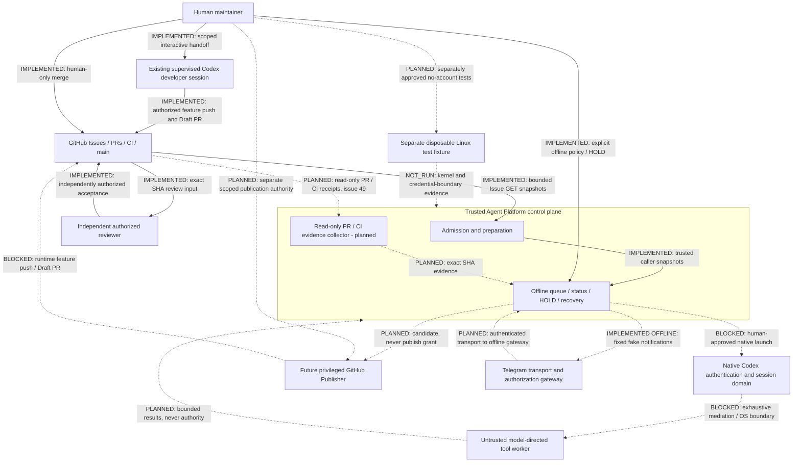

# ADR 004: MVP.5 architecture and trust-boundary freeze

Specification: **AP-TB/1**, 2026-11-02, Issue #46. Status: architecture decision
for independent review; **no runtime activation**. Source baseline:
`4e53cac6d2368fdf385574cf12109f169c04c2ba`. GitHub Issue and roadmap observations
are a remote snapshot on this date, not permanent authorization. Changes to this
contract require a separately scoped, independently reviewed revision; this
version does not change any executable interface or persisted schema.

## Binding decisions and scope

Stock native Codex CLI, funded by the operator's ChatGPT subscription, remains
the sole selected future execution engine. Agent Platform is its orchestrator,
not a replacement agent or Responses transport. [ADR 003](subscription-transport.md)
is binding; its earlier B/SIWC and C/custom-agent research is historical and not
approved. [ADR 001](subscription-architecture.md), [ADR 002](tool-dispatch-feasibility.md)
and the [native adapter contract](native-codex.md) retain their security limits.

The existing human-supervised interactive developer session is distinct from an
autonomous Agent Platform native runtime. The former can deliver a scoped Draft
PR under direct human authorization and supported sandbox approvals. The latter
remains **SUBSCRIPTION_ISOLATION_BLOCKED, exit 13**. Neither repository prose nor
this ADR grants credentials, execution, publishing, provisioning or scheduling.

**Legacy decision, implemented by Issue #47:** public `run`, `resume` and
`doctor` now return fixed `legacy_execution_quarantined` JSON and exit 13 after
argument validation, before cwd/repository/Git/GitHub, credentials/session, lock,
checkpoint, broker, probes or subprocesses. They do not route to the legacy
executor or native adapter. `subscription` retains its separate native block.
See [exact public response](execution.md). Internal `execution.execute` still
supplies `codex.arguments` to `_execute`, and internal `doctor.diagnose` retains
legacy diagnostics for offline analysis/tests only, never native readiness or
operator launch authority. The API broker is not an authorized fallback.

The original #46 freeze was documentation-only. This #47 amendment records only
public quarantine; historical lifecycle evidence, native gates, caps and schema
remain unchanged. Stock subscription Codex is still the sole future engine.

## Implemented inventory versus intended integration

All Python references below are under `src/agent_platform/`. Existing modules
are separate bounded components, not a live integrated orchestrator. Their
presence does not establish an authenticated caller or production deployment.

| Responsibility | Existing implementation / evidence | Proposed or blocked part |
| --- | --- | --- |
| Repository and Issue admission | `cli.inspect`, `issues.GitHub`, `issues.validate_candidate`, `issues.provenance`, `prepare.approved`: bounded GETs, complete label history, stable rereads, explicit operator actors and scope/revision pins | Scope syntax is not semantic safety; no server-side authorization service or Issue claim |
| Preparation | `prepare.prepare`, `state.host_lock`: explicit Issue, private worktree/checkpoint, durable intent, fixed host mutex | No automatic preparation or queue-driven start |
| Queue / dependencies | `queue.Policy`, `capture`, `plan`, `PullRequest`: bounded operator policy, supplied receipts, local ancestry checks; [queue contract](queue.md) | `next_candidate` is advice; no scheduler or PR evidence client |
| Trusted control plane | Existing admission, state, status and planning functions called by a trusted operator/controller | Unified controller and authenticated evidence delivery are not implemented |
| Execution / checkpoints | `execution.execute`, `_execute`, `validate_record`; `codex` event parser; `state` atomic persistence and guards; [lifecycle](execution.md) | Legacy internals retained for offline tests; public run/resume quarantined; native runtime cannot launch |
| Native auth/session owner | `native_codex.arguments` is a pinned parser seam; `native_codex.execute` rejects unconditionally before inspection/locking/writes; `subscription.readiness` is inert | No production subscription login, refresh, account binding or credential-safe session owner integration |
| Model-directed tools | Legacy `_sandbox.py` and `isolation.Profile` constrain a credential-free runtime | No complete supported native dispatcher separating every built-in operation from credential-owning Codex |
| Linux isolation / native canaries | `isolation`, `runtime_manifest`; separate `native_canary` and `_native_canary_probe`; [canary contract](native-canary.md) | Offline mocks are not live kernel proof; reviewed disposable fixture unavailable to this task |
| Native artifacts | `native_artifact`, `_native_elf`: bounded static pinned candidate/ELF inspection; [artifact contract](native-artifact.md) | INSPECTED_NATIVE_CANDIDATE is not RUNTIME_ADMITTED; native 384 MiB inspection cap does not relax legacy 256 MiB gates |
| GitHub PR / CI collector | Queue and publisher accept typed trusted caller evidence | Issue #49 adds `github_evidence.collect` with an explicit bounded client and immutable receipts; [contract](github-evidence.md); live auth/OS integration not demonstrated |
| Future Publisher | `publisher.Admission`, `TestEvidence`, `plan`: offline exact-change inspection; [publisher contract](publisher.md) | `publish_authorized=false` always; no authenticated writer, commit/push/PR operation or runtime CLI |
| Status / HOLD / recovery | `task_status.inspect_local` / `diagnose`, `subscription_hold.report` / `set_hold`, `recovery.plan`; [status](task-status.md), [HOLD](subscription-hold.md), [recovery](recovery.md) | No liveness proof, HOLD release/enforcement wiring, process signalling, automatic recovery or native resume |
| Telegram notifier | `notifications`, `notification_outbox`, `telegram_fake`; trusted events, fixed formatting, private outbox; [notifier](telegram-notifier.md) | Default disabled; fake transport only, no token/network sender |
| Operator console | `telegram_console.parse`, `collect_reports`, `Gateway`, `FakeInbox`; [console](telegram-console.md) | Offline synthetic commands and dry-run callbacks; no authenticated live transport or action dispatcher |
| Developer and independent review | [Supervised contributor workflow](development.md): human-authorized interactive worktree, commit, push and Draft PR; separate SHA-pinned reviewer | Runtime gets none of these rights; reviewer transitions need independent authority; only human merges |

## Trust domains and data flow

Solid arrows marked IMPLEMENTED refer to current bounded operations or the
manually supervised workflow. Dashed arrows are intended interfaces, never
launch authorization. BLOCKED is an unavailable connection, not a fallback.

The control-plane box is a logical responsibility, not an existing service or
security container. Telegram has no executable edge to launch, HOLD release,
publisher or review. The development VM **dev01 is not Issue #28's disposable
kernel-test fixture**. No fixture, broker, daemon or background session is
created by this specification.

## Security-domain contract

The following is the frozen **intended minimum** for future integration, except
where explicitly identified as current behavior. Process identities and socket
paths that have not been implemented are requirements, not deployed facts.
Each domain must default to denial on missing, changing or contradictory evidence.

| Domain / trust and principal | Operations, authority and credentials | Filesystem / mounts / descriptors / network | Forbidden actions and failure handling |
| --- | --- | --- | --- |
| Human maintainer: root of scoped policy authority, not model output | Direct handoff, trusted actor policy, approvals, account decisions and sole merge decision; owns account authority | Uses independently authenticated operator channels; no credential contents belong in task files, logs or receipts; approvals do not grant worker mounts or inherited FDs | No implicit delegation from Issue text; ambiguous approval stops the dependent action |
| Existing interactive developer: supervised, unprivileged `agentdev` on dev01; repository/model input untrusted | Human grants one Issue's implementation and feature/Draft delivery through supported approvals; existing GitHub environment performs delivery without exposing secrets | Original checkout preserved, dedicated feature worktree writable under sandbox; repository-scoped GitHub network for verified delivery; no credential-store inspection, host configuration or secret copying; no new auth FD/socket inheritance granted | Cannot perform independent acceptance, merge, runtime activation or unrelated work; blocked approvals/network are reported, never bypassed |
| Trusted control plane: trusted operator process; no hostile code imported | Owns admission, scope/policy, host mutex, atomic checkpoint/guard and exact lineage; future collector/publisher credentials remain compartmentalized, never task data | Installed trusted code outside writable task tree; private state `~/.local/state/agent-platform/<repo-id>/issue-N.json`; runtime worktrees `~/.local/share/agent-platform/worktrees/<repo-id>/issue-N`; bounded local Git/explicit Issue GETs only; fixed `/var/tmp/agent-platform/prepare.lock`; lock FD never available to worker | Never execute repository instructions, auto-select/retry/repair, infer authorization or pass control-plane secrets to Codex; uncertain persistence retains evidence and NEEDS_HUMAN |
| Native Codex auth/session owner: intended trusted TCB, runtime BLOCKED | Stock pinned Codex alone would own subscription auth, refresh and exact native session; account/workspace binding still undesigned, not inferred from UUID | Future private CODEX_HOME, auth store/keyring, session files and minimal fixed inference egress; not mounted in worker; no worker-readable auth env, proc, FD or socket; exact OS principal separation not demonstrated | No OAuth forwarding, API fallback or task code in this domain; missing complete mediation blocks before any inspection or launch |
| Model-directed worker: hostile code and descendants, no authority | Approved task edits and bounded tools only after separately reviewed launch; no credentials or authoritative receipts | Intended separate OS-enforced mount/PID/network/IPC/user boundary, credential-free immutable runtime, approved `/workspace`, private tmp/dev/proc; no host home, common Git dir, state, keyring, agents, auth/session mounts or credential/lock FDs; only bounded typed result channel; no arbitrary egress | No publisher/GitHub/auth/control-plane access, parent inspection or surviving jobs; failed denial probe means isolation_unavailable, no privileged fallback |
| Read-only GitHub evidence collector: future trusted identity, separate from Codex | #49 will own least-privilege repository read credentials and verify remote receipts; operator pins accepted repository/policy | Trusted install/private credential source outside all coding mounts; fixed GitHub HTTPS read endpoints, bounded pagination/time/output; only sanitized typed evidence crosses IPC, never token or HTTP client | No GitHub mutation, auth from target JSON or treating cached assertions as fresh facts; incomplete/rate-limited/drifting results unavailable, no partial grant |
| Privileged GitHub Publisher: future separate trusted principal, not implemented | Separately authorized exact feature commit/push/Draft PR only; owns distinct least-privilege write credential; plan is not authority | Future validated source/common/worktree inspection under lock, credential never enters child/Telegram; fixed repository GitHub/Git egress and bounded authenticated channel, no generic proxy or inherited writer socket | No main push, force, merge, permission changes or model-selected destination; persist intent before effects, uncertain outcome requires read-only reconciliation, never blind replay |
| Telegram transport / gateway: transport untrusted until authenticated; offline gateway trusts only explicit policy/context | Future transport alone owns bot credential; numeric sender/private-chat pair and bot context permit bounded read views only; callbacks are non-executable proposals | Current separate private cursor/pending/outbox storage, fixed safe replies and fake transport; no token/network today; future IPC cannot carry auth/session paths, raw logs or control-plane credentials | No inbound mutation, arbitrary body/link/destination or authority from chat; lost/changed queue or uncertain send blocks without repair, eviction or unknown-send replay |
| Disposable Linux fixture: independently reviewed, synthetic-only unprivileged tester | Separate operator opt-in for #28/#51, fabricated sentinels and fixed probes; owns no real credentials | Explicit immutable runtime/provenance, private test mounts, namespaces and local synthetic listener only; deny host home/library mounts, sockets, public network and privileged fallback; bound/reap fixture descendants | Cannot provision dev01, read real stores, authenticate, infer entitlement or admit runtime; absent fixture is BLOCKED/NOT_RUN |
| Independent reviewer: separately human-authorized, independent of implementer | Reviews exact HEAD, evidence and one linked open Issue; may publish COMMENT, Ready, Completed only after fresh gates; human alone merges | Uses separately authorized GitHub interface; no worker credentials/FDs or host probe rights; review facts bound to exact repository/head/base | Old PASS, missing/red/pending checks or changed SHA blocks; reconcile partial transitions, never claim failed mutations succeeded |

### Process and data-plane requirements

Same UID plus `0700` directories is not a hostile-code boundary: a process may
reach sibling files, `/proc/<pid>/environ`, memory, `/proc/<pid>/fd`, ptrace paths,
keyring/session services or shared Unix sockets, subject to actual kernel policy.
Environment filtering alone cannot close inherited FDs, agent sockets, parent
memory or discovered files. Yama alone is insufficient. A future proof must
measure real principal/namespace identities, capability sets, mount propagation,
proc visibility, descriptor closure, socket peer admission and descendant lifetime.
No host D-Bus/keyring, SSH agent, Docker socket, shared auth mount or refresh
channel may become a generic worker capability. Credential-reading tools can
exfiltrate through normal result/model output even without direct network egress.

The existing **legacy**, credential-free isolation profile mounts only its curated
read-only rootfs, writable worktree, read-only `.git` pointer, private tmp/dev/proc
and fresh `/codex-home`; the host common Git directory is absent. Its namespace
supervisor holds the sync/lock lifetime FD, not the worker. It uses a fixed broker
socket with root peer checking, not native subscription auth. These source-level
controls and synthetic tests do not attest a deployed profile or a native tool
boundary. See [execution.md](execution.md) for exact legacy mounts, paths and caps.

Frozen dataclasses constrain accidental mutation inside Python; hostile code in
that process can fabricate them. SHA-256 digests correlate exact bytes and detect
changes against a trusted reference; an attacker can hash forged bytes too.
Trusted caller assertions assume caller provenance rather than authenticate it.
None supplies cryptographic principal identity, remote freshness, account ownership
or exactly-once side effects. Git SHA identifiers similarly bind lineage, not
permission. Future IPC must authenticate principals under an independently
reviewed OS/channel policy and bind receipt provenance; no receipt file loaded
from the target tree may bootstrap that trust.

## Native security NO-GO and version boundary

The unresolved edge is **credential-owning trusted Codex → exhaustive dispatcher
→ isolated untrusted tools**. Experimental `dynamicTools` / `item/tool/call`
callbacks prove only an explicit subset. They do not intercept the separate
built-in registry. Every route must be proven mediated or immutably disabled,
including nested/alternate dispatch and configuration/extension discovery:

| Surface | Missing proof, retained from ADR 002; not a new upstream audit |
| --- | --- |
| shell / exec / PTY / write_stdin | Every spawn and fallback, one-shot execution and shell patch interception uses the same enforced worker boundary |
| apply_patch / file reads, writes, search and images | Internal handlers and indirect file operations cannot access the auth/session domain, including read-only leaks and symlink races |
| MCP / connectors / plugins | Discovery, servers and extension subprocesses cannot inherit secrets, sockets or alternate tool authority |
| subagents / code mode | Nested agents, JS/code execution and delegated tools inherit no larger capability; no callback bypass |
| hooks / background processes | Startup/turn hooks and descendants cannot execute in trusted domain or survive cancellation/parent death |
| resume / credential refresh | Exact UUID, account and policy remain bound across refresh/restart; refreshed tokens, session data and inherited descriptors stay outside worker reach |
| alternate / hosted dispatch routes | Unknown internal routes, feature flags and fallback handlers are denied, not assumed covered by dynamic callbacks |

A VM around all of Codex or a successful Bubblewrap host-containment probe does
**not** prove tools cannot read credentials inside Codex's own domain. Mandatory
OS enforcement must deny parent memory/proc, keyring, auth files, environment,
FDs and sockets while permitting only approved worktree operations. Whole-CLI
containment and exhaustive native tool mediation require separate evidence.

The operator reports interactive Codex **0.166.0** on dev01. Historical source,
schema, parser and artifact evidence remains pinned to **0.164.0** in
[tool-dispatch-evidence.json](tool-dispatch-evidence.json) and
[native-artifact-evidence.json](native-artifact-evidence.json). This milestone
runs no Codex process and updates no pin or attestation. An installed version
string is not compatibility, source-to-binary or isolation proof. Native static
inspection's separate 384 MiB ceiling does not admit a runtime or change the
legacy 256 MiB limits. Unknown coverage means NO-GO, not account testing.

## AP-TB/1 conceptual interfaces

These are **conceptual integration envelopes**, not new Python classes, wire
schemas or checkpoint migrations. Existing API schemas remain as linked above.
No proposed envelope is executable or accepted from target files/model output.
All have `spec=AP-TB/1`, type, issuer/provenance, observation time, policy revision,
canonical repository ID/name, Issue ID/number/revision/scope digest and exact
base SHA. Downstream stages additionally bind current head/tree/change inventory,
checkpoint generation/digest, execution ID and exact session UUID where present.
Unknown fields/versions, missing pins or contradictory identities reject the
whole envelope. A null session before execution never selects a recent session.

| Envelope | Required content and authority boundary |
| --- | --- |
| ActorPolicy | Operator-authenticated assertion of trusted logins, repository/scope and policy provenance; no authority imported from Issue labels/prose alone; no existing cryptographic login authenticator claimed |
| AdmissionSnapshot | Existing complete open-Issue/label provenance, stable rereads and scope/base pins; eligible is not launch permission |
| QueueProposal | Operator-owned dependencies/priorities plus admission and exact merge receipts; candidate and blockers only, never selection/start authority |
| GitHubEvidenceReceipt | Issue #49 collector provenance, repository/default main, PR source/head/base, single Issue association, independent reviewer identity and exact reviewed SHA, required check identities/status, actual merged state/merge SHA and observed local ancestry; unavailable is not false/green |
| HumanDecision | Explicit scoped operation, actor/channel provenance, current evidence pins and expiry/one-use reference; future runtime authorization protocol requires separate review, not a boolean supplied by model |
| TaskObservation | Recorded checkpoint/guard/ref identity, HOLD/recovery evidence, snapshot consistency and `live_activity=unknown`; no inferred idle or replay safety |
| PublisherProposal / Authority | Existing offline candidate remains `publish_authorized=false`; a future separate short-lived single-operation authority must bind exact changes/receipts and destination; never derive it from candidate/idempotency hash |
| TelegramProposal | Authenticated transport provenance would precede numeric caller/chat and trusted bot context; immutable exact operation/task/expiry/one-use binding; current callback stays dry-run and grants no action authority |

Freshness is transition-local: reread immediately before each authorized effect,
compare the entire pinned snapshot and fail if it changed. AP-TB/1 defines no
magic TTL that makes old facts safe. Expiry is an additional upper bound, never
a replacement for rereads. The local mutex cannot make GitHub reads atomic or
stop external Git writers; require quiescent local inputs and remote drift
checks. Separate hosts need a separately reviewed coordination design.

## State transitions, effects and recovery

The conceptual flow is Issue → Admission → Queue → Human decision → Codex →
Checkpoint/HOLD/Recovery → Publisher → Draft → Independent review → Human merge.
Only individual components and supervised delivery exist; no end-to-end native
flow is enabled. Every row inherits the envelope identity/scope/SHA/freshness
rules above and denial on missing, replayed, changed or conflicting evidence.

| Transition / current status | Trusted evidence, identity and freshness | Lock, persistence, effects, replay and approval |
| --- | --- | --- |
| Issue → Admission: implemented | Explicit operator actors; exact repo/Issue IDs, current open status, scope/revision, blocking labels, complete current provenance and stable repeated reads | Bounded read-only GETs; no claim/write/launch; failed bounds or drift discards all; human scope review remains separate |
| Admission → Queue: implemented offline API | Trusted priority/dependency policy and snapshots; dependency completion requires actual merged PR, exact repository/main/head and local merge ancestry | Non-creating fixed host lock for local planning; no effects beyond bounded report, no automatic nomination-to-prepare; retained tasks/unknown state block; closed Issue is not merge evidence |
| Queue → Human decision / prepare: manual only | Human chooses one explicit Issue; fresh admission/base and canonical source/common/worktree, all refs/cleanliness and path-conflict checks | Existing runtime prepare persists intent under fixed host lock before dedicated branch/worktree writes and atomic checkpoint; supervised developer preparation is the separate workflow; uncertain creation is never repeated or deleted automatically |
| Human decision → native execution: BLOCKED | Future separate reviewed launch scope, exact prepared identity, fresh admission, runtime/account/policy and exhaustive OS/tool proof | Today native rejects before inspection/locking/writes. No decision envelope can bypass it. Legacy is not fallback; future implementation must retain full-lifetime lock and durable intent before any child |
| Execution → checkpoint: legacy lifecycle / offline native tests | Exact `thread.started` UUID, expected runtime/session lineage, bounded validated events and child exit, changes/ref checks | READY → STARTING intent/guard → RUNNING (UUID durable before more events) → COMPLETED or PAUSED; full child lifetime lock; atomic fsync/replace and expected-record checks; unknown exit/stream/write becomes NEEDS_HUMAN with guards/evidence retained, never success/replay |
| Checkpoint → HOLD/status/recovery: offline components | Same repository/Issue/session/generation, lock/guard/store observations; explicit trusted human HOLD, not token counts or quota prose | Non-creating lock, separate atomic HOLD storage; status/recovery read-only; WAITING is presentation, not checkpoint replacement or quota fact; no release, signalling, repair or resume; missing HOLD means unknown, not permission |
| PAUSED → same-session resume: legacy only; native BLOCKED | Legacy: fresh admission, exact UUID, session-file lineage/digest, pinned runtime/profile and refs; future native additionally requires account/policy binding, not implemented; preserve legitimate coding edits | Explicit operator invocation only; STARTING resume intent, attempt increment and same UUID; no latest-session selection, automatic retry or migration from synthetic/native evidence; contradictions require human reconciliation |
| COMPLETED → Publisher candidate: implemented offline | Trusted current admission/test receipts bound to checkpoint and full tree/exact changes; terminal record, no guard/temp conflict, canonical worktree/common/all refs | Existing non-creating host lock; bounded read-only inspection, deterministic correlation key; no auth, commit/push/PR; repeated candidate is not remote idempotency or publish permission |
| Candidate → Draft PR: future runtime BLOCKED; supervised delivery implemented | Future separate publisher authority and fresh exact source/base/head/tree/checks/Issue/destination pins; supervised developer uses direct human task authorization | Future durable intent and operation-specific reconciliation required; unknown commit/push/PR outcome must be inspected, never replayed blindly. Current developer stages scoped files, commits once, pushes only feature branch and creates/verifies one Draft with one closing link; no main/force/merge |
| Draft → independent acceptance: supervised only | Independent PASS for exact unchanged HEAD, expected open PR/head/base, single linked open Issue, required checks completed green and no blockers, reread before each mutation | Separately authorized reviewer publishes COMMENT, verifies, then revalidates Ready, verifies, then revalidates Issue Completed; partial failures reported accurately. Old PASS cannot validate new SHA; pending/missing/red checks leave Draft/open; no formal approval or merge implied |
| Accepted PR → human merge: human only | Human's fresh review of current PR/base/head/governance/checks; collector later verifies actual merged state, merge SHA and local main ancestry | No runner, developer, publisher or Telegram auto-merge. Closed Issue/Ready/COMPLETED checkpoint proves neither merge nor exactly-once work; uncertainty stays UNKNOWN until independently reconciled |

Existing v1 preparation and v2 execution schemas remain unchanged. See
[execution.md](execution.md) for actual generation/attempt rules, event bounds,
fixed lock and guard lifecycle. Only known `turn.completed` with valid usage and
exit 0 yields COMPLETED; known `turn.failed` with exact session and exit 0/1 yields
PAUSED. Other ambiguous outcomes need human reconciliation. A persisted RUNNING
record is **not actual process liveness**; a free lock or missing terminal output
is not proof a side effect did not happen. No automatic cleanup, resume or replay
follows. HOLD currently has no mandatory runtime enforcement/release integration.
A quota-looking error, stderr or usage counter does not prove subscription
exhaustion, remaining allowance or reset time; no verified_limit source exists.

## Evidence levels and acceptance matrix

Levels describe a bounded claim, not an overall safety badge. Record source,
exact version/SHA/policy, observer, time and scope with each claim. Distinct
levels may apply to different properties of the same component.

| Level | Meaning |
| --- | --- |
| VERIFIED_OFFLINE | Repeatable synthetic/static/local contract evidence for precisely identified inputs; no remote auth or live kernel guarantee |
| VERIFIED_REMOTE_SNAPSHOT | Authenticated read-only remote observation at a stated time and exact identity/SHA; not durable permission or atomic freshness |
| BLOCKED | A required gate is known unsatisfied; dependent effects forbidden |
| NOT_RUN | A particular experiment/action was not performed; no positive or negative outcome inferred |
| UNKNOWN | Missing, inconsistent, stale or insufficient evidence; fail closed |
| REQUIRES_INDEPENDENT_REVIEW | Evidence/design awaits an independent exact-version/SHA assessment; not a PASS |

| Claim / boundary | Current evidence classification | Acceptance needed; what it does not establish |
| --- | --- | --- |
| Synthetic CI / component contracts | VERIFIED_OFFLINE when exact-SHA checks pass; this PR reports actual local/CI results separately | Ruff/pytest/diff success proves bounded offline behavior, never production safety or paid E2E |
| Issue #46 identity and roadmap | VERIFIED_REMOTE_SNAPSHOT on 2026-11-02 | Revalidate before effects; snapshot is not native admission or future Issue authorization |
| PR/CI/merge receipt verification | Existing typed planner fixtures VERIFIED_OFFLINE; dedicated live collector NOT_RUN / #49 | Fresh authenticated complete receipt, exact current SHA/reviewer/checks/Issue and local ancestry; a model PASS string is insufficient |
| Real Linux confinement | #28 fixture BLOCKED; kernel tests NOT_RUN in this milestone | Reviewed immutable fixture, actual namespace/mount/proc/FD/network/descendant negative probes plus allowed-work positive probe; mocks not kernel evidence |
| Credential-domain separation | BLOCKED / REQUIRES_INDEPENDENT_REVIEW | Deny synthetic auth/keyring/env/proc/memory/FD/socket access across actual worker boundary; whole-VM containment insufficient |
| Exhaustive native tool mediation | UNKNOWN coverage, therefore BLOCKED | Exact-build full dispatch inventory, immutable denial or mediation for every nested/alternate route; dynamicTools subset insufficient |
| Native artifact/runtime admission | Static candidate evidence VERIFIED_OFFLINE; runtime admission BLOCKED | Exact provenance, immutable root-owned full runtime, explicit ELF closure and independent unchanged caps/profile gates; inspection is not installation |
| Authenticated subscription, refresh and resume | NOT_RUN / BLOCKED | Separate future authorization only after security gates; no real account probing or token transfer permitted here |
| Runtime Publisher / live Telegram authority | Offline proposals VERIFIED_OFFLINE; live paths NOT_RUN / BLOCKED | Separate authenticated principals, least privilege, fresh one-use operation grant and uncertain-effect reconciliation; hashes/numeric IDs not identity proof |
| End-to-end readiness | BLOCKED / REQUIRES_INDEPENDENT_REVIEW | All preceding gates plus separately authorized account E2E in approved fixture; no offline or remote snapshot PASS promotes deployment |

## P0/P1 threat and risk register

P0 blocks affected runtime/publication activation. P1 blocks acceptance of the
corresponding integration until resolved or explicitly scoped by independent
review; no risk classification grants a bypass.

| ID / severity | Boundary and scenario | Existing controls | Missing evidence / potential impact | Required mitigation and owner gate |
| --- | --- | --- | --- | --- |
| R01 P0 | Issue/repository/model → control plane: prompt injection fabricates authority or commands | Fixed argv, untrusted prose, actor/scope pins, bounded reads | Semantic scope and future integration audit; arbitrary host actions | Keep policy out of target/model, validate provenance and every effect; #46 contract, #49/#51 integration |
| R02 P0 | Worker → future Publisher: forged tests/change plan triggers unauthorized GitHub publication | Offline `publish_authorized=false`, exact inventory/receipt checks, no runtime writer | Authenticated writer boundary absent; unauthorized commit/push/PR or merge | Separate credential principal and explicit exact-operation grant, durable reconciliation; future Publisher milestone after #49, no current authorization |
| R03 P0 | Public legacy CLI → API broker: native blocker escaped through old execution route | Public pre-I/O quarantine, legacy isolation checks, native-only selection | Public guard tested offline; internal code remains, future dispatch changes could reopen unintended launch | Pre-inspection fail-closed entrypoint quarantine, no fallback; #47 |
| R04 P0 | Native tools → auth owner: credential exposure through read/patch/MCP/alternate dispatch or refresh | Unconditional native gate, no account probes | Exhaustive dispatch and credential denial unproven; token theft/account compromise | Full inventory and immutable OS mediation/disablement; #51, separately reviewed future auth milestone |
| R05 P0 | Same-UID worker → trusted process: proc/env/memory/keyring/FD/Unix socket access | Legacy namespaces/root peer contract; no reliance on 0700 alone | Actual native principal/FD/proc boundary unproven; control-plane takeover | Real negative probes and authenticated narrow IPC, no shared credential domain; #28/#51 |
| R06 P0 | Hooks/subagents/background/resume → persistent privileged path | Bounded lifecycle, exact UUID, cancellation/reaping tests, native gate | Complete descendant/refresh/alternate route coverage missing; persistent secret access | Exact-build exhaustive mediation and real cancellation probes; #51 |
| R07 P1 | GitHub → queue/review: stale scope/head/CI or Issue closed mistaken for merged | Stable Issue reads, pins, queue local ancestry with supplied receipts | Live PR collector/governance unverified; wrong dependency or acceptance | #48 governance evidence, #49 fresh complete receipts and drift rejection |
| R08 P1 | Persistent state → decisions: replay or crash misread as idle/completed | Atomic intent/checkpoints, guards, host lock, recovery plans, no auto-retry | Cross-component reconciliation and uncertain remote effects; duplicate or lost work | #50 offline supervisory snapshot; future separately reviewed publisher journal; no blind replay |
| R09 P1 | HOLD/usage → launch: absent HOLD or quota prose grants resume | Separate explicit human HOLD; no quota classifier/release | Mandatory enforcement and account-limit authority absent; unintended retry/spend | #50 reports unknown/no launch; future scoped release/enforcement design, never infer reset |
| R10 P0 | Telegram → trusted actions: forged sender/chat/context/callback or replay | Strict offline schema, fixed replies, replay/pending storage, dry-run callbacks | No authenticated live transport; impersonation/publication/control | Separate future transport authorization review and principal proof; #38 offline limits remain, no live milestone approved |
| R11 P1 | CI/dependencies → review: mutable action or false independent PASS | Offline tests, exact-SHA review workflow, human-only merge policy | Private repository rules/required check enforcement not attested | #48 immutable Actions and governance documentation; independent review cannot be replaced by implementer assertions |
| R12 P0 | Artifact/fixture → security claim: version drift or synthetic PASS presented as confinement | Pinned 0.164.0 evidence, static inspector separate caps, hard native block | 0.166.0 equivalence and real fixture unknown; invalid isolation assumption | #28 reviewed fixture, #51 exact-version evidence; never silently repin or provision dev01 |

## Roadmap dependencies and GO/NO-GO

These links record the current Issue snapshot, not instructions to start work.
Every next Issue requires fresh verification, explicit maintainer handoff,
independent exact-SHA review, green required checks and human merge of its
prerequisite. No label, roadmap order or merge automatically launches anything.

| Issue | Dependency and acceptance boundary |
| --- | --- |
| [#47 legacy quarantine](https://github.com/TechTradeExpress/Agent-Platform/issues/47) | Implements public pre-I/O run/resume/doctor refusal after #46; preserve native exit 13 and historical tests; independent exact-SHA review/green CI and human merge remain acceptance gates |
| [#48 governance / CI](https://github.com/TechTradeExpress/Agent-Platform/issues/48) | After human merge of #47; independently verified immutable Action SHAs, least privilege and exact-SHA CI; document actual private-repo governance constraints without changing administration |
| [#49 read-only collector](https://github.com/TechTradeExpress/Agent-Platform/issues/49) | After human merge of #48; bounded authenticated PR/CI/merge facts, exact head/base/Issue/reviewer and local ancestry, no writer or worker-visible credential |
| [#50 offline supervision](https://github.com/TechTradeExpress/Agent-Platform/issues/50) | After human merge of #49; consistent admission/queue/status/HOLD/recovery report, always launch_allowed=false and resume_authorized=false; no release, signalling or cleanup |
| [#28 disposable Linux fixture](https://github.com/TechTradeExpress/Agent-Platform/issues/28) | Approved #46 architecture and independent fixture specification; real provisioning and kernel runs separately operator-approved in disposable VM only; absent fixture remains BLOCKED/NOT_RUN |
| [#51 native GO/NO-GO](https://github.com/TechTradeExpress/Agent-Platform/issues/51) | Approved #46 and independently reviewed #28 specification; exact-build exhaustive tool/credential proof, synthetic negative probes only in separately approved fixture; any unknown route yields NO-GO, never auth activation |

A security GO would require all credential, tool, artifact, lifecycle and real
kernel gates independently demonstrated for the same exact build/profile.
Even that evidence is not permission for login/inference: authenticated E2E and
runtime activation need separate implementation scope and explicit authorization.
Current verdict is **NO-GO**. [Issue #18](https://github.com/TechTradeExpress/Agent-Platform/issues/18)
is a separately authorized ChatGPT Automations / condition_watch initiative,
not a dev01 daemon, scheduler or local polling process. No automation is created.

## Independent reviewer checklist

- Compare the inventory and legacy/native routing against the pinned source;
  verify proposed envelopes and controls are not claimed as existing APIs.
- Confirm the diagram, domain table and risks cover credentials, same-UID/proc,
  keyring/env/FD/socket/mount access, all tool routes and descendant persistence.
- Confirm stock subscription Codex selection, unconditional native block/exit 13,
  unchanged historical 0.164.0 pins/caps and distinct interactive 0.166.0 context.
- Check exact PR HEAD/base, documentation-only diff, one Issue link, actual local
  test failures and exact-HEAD CI. Offline green never establishes kernel/auth E2E.
- Revalidate independent PASS, unchanged SHA, green required checks and no blockers
  before each separately authorized acceptance mutation. Implementer stops at
  Draft; only human merges. This architecture freeze initiates no other Issue.
