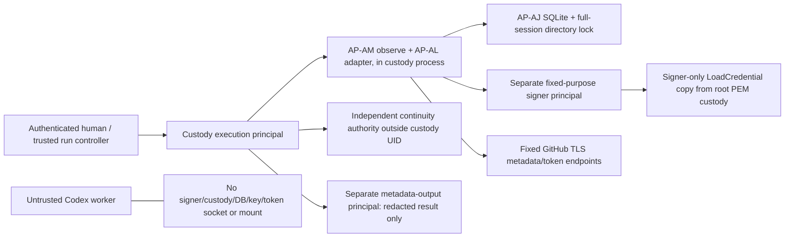

# AP-AJ/1 — durable custody journal and future host separation

Issue #78 is offline source only. `custody_journal.SQLiteJournal` implements
AP-AL/1's complete/snapshot/append interface; it is not wired into an enabled
runtime or service. No signer, IPC server, key access, token operation, publisher01
connection, system-user change, deployment or worker activation occurs here.
All App transport in tests is mocked. AP-AL/1/AP-AM/1/AP-CI/1/AP-CA/1 code and
metadata-only/non-authorizing semantics, review/publication gates and exit 13 stay.

## Explicit approval and provisioning

There is **no default path, environment lookup, implicit create or replacement**.
An independently trusted operator chooses an existing private directory and:

- `Namespace`: schema 1, approved namespace digest, existing AP-AM Pins (including
  App/registration owner, installation/target owner, repository/default branch and
  Metadata read profile) and exact custody-source digest.
- `StoreIdentity`: namespace, independent store ID, expected directory/DB device
  and inode identities, allowed filesystem class and storage-evidence reference.
- `Anchor`: exact expected event count and canonical history digest, retained
  outside this DB and supplied independently on every open/restart.

`provision(directory=..., namespace=..., store_id=...,
storage_evidence_sha256=...)` is a separate explicit inert bootstrap API, never
called by imports, open or retry. It requires an existing **empty 0700 directory**,
creates only `custody.sqlite3` with exclusive creation/0600, provisions schema and
syncs DB/directory. It returns identity/empty anchor for independent retention.
Partial files remain after failure; subsequent bootstrap refuses nonempty storage.
No directories are created, repaired/chmodded, replaced, rotated or removed.
The API is not an operator-authentication mechanism; model/source JSON cannot
supply authority, and returned hashes/inodes do not authenticate the operator.

Runtime construction requires explicit directory, StoreIdentity and Anchor and
opens `mode=rw`, never rwc/readonly/immutable or in-memory fallback. Wrong or missing
pins, anchor, file, schema or storage evidence blocks. Namespace rotation cannot
open the old store under new App/installation/repository/source pins. Independent
approval must also prevent creating a separate fresh namespace to hide unresolved
old history; a local library cannot prove the global absence of other stores.

## Filesystem, locking and SQLite policy

Shared state owner/mode/ancestor checks are reused without creation. A descriptor
walk uses O_NOFOLLOW/O_DIRECTORY, a private final directory and a regular 0600,
owner-matching, single-link DB. Parent symlinks/unsafe writable ancestors fail;
root sticky /tmp and /var/tmp are allowed only as ancestors of the private root.
Paths are explicit nonsecret operator data, never credential locations. File and
directory descriptors/inodes remain pinned and are rechecked around operations.
SQLite's reported main DB inode must match; no attached database is allowed.

A nonblocking exclusive Linux **directory flock** is held for the full session,
not just a transaction. Contenders fail immediately before opening a DB FD. This
also avoids a same-process contender closing another DB descriptor and thereby
dropping SQLite's POSIX record locks. Closing the owner session/process releases
the lock; no lock file is unlinked, stolen or recreated. Sessions are for their
owning process/thread; inherited SQLite state must not be used after fork.
Locks are advisory: hostile same-UID code or storage administrators are outside
this assurance and must be excluded by the future host boundary.

Linux fstatfs must identify an allowed local ext-family or XFS class and not a
read-only mount. Overlay, tmpfs, network and unknown filesystems fail closed. The
ext-family magic alone does not distinguish ext2/ext3/ext4 or prove journaling,
barriers, device flush honesty, virtualization or durable media. An independently
reviewed storage-evidence reference is mandatory; the operator must verify the
actual filesystem/mount/storage stack. A digest is not that verification. Tests
fabricate the approved statfs profile on temporary storage; they do not promote
CI/container storage or publisher01 to a verified durable host.

SQLite uses rollback `journal_mode=DELETE` and connection-local
`synchronous=EXTRA` explicitly set and verified; unsafe existing WAL/PERSIST/etc.
is rejected, never converted on open. Every read/append rechecks safety settings.
Foreign keys/checks/cell checking are on; trusted schema/recursive triggers are
off, query-only/readonly/immutable mode is not accepted, extensions are disabled,
temp storage is memory, mmap off, cache 256 KiB, busy timeout zero. SQL is fixed
and parameterized; attached DBs, unknown schema objects, indexes/triggers/views,
versions, identity rows, noncanonical payloads and invalid history fail closed.
SQLite quick_check may instantiate only its empty in-memory temp DB, not another
persistent database. No production SQL/query interface is exposed.

Limits: 128 retained Events, 2 KiB/event, 256 KiB DB (64 x 4096-byte pages), bounded
rollback sidecar and SQL/SQLite limits, LIMITed row reads and a one-second SQLite
VM progress budget. Busy locks do not wait/retry. Kernel disk I/O/fsync cannot be
physically preempted by a Python progress callback; host storage failure/latency
and process supervision require independent verification, not a hard realtime
claim. Snapshot compares metadata plus a bounded physical file hash before/after
reads, exact logical history and the supplied anchor. These are local drift checks,
not signatures or protection from a malicious custody UID.

Before SQLite opens, any pre-existing rollback/WAL/SHM/unknown sidecar blocks and
is preserved, preventing implicit hot-journal recovery. Normal successful SQLite
DELETE commit removes its own transient rollback journal; this is transaction
protocol, not cleanup of pre-existing evidence. Explicit close may roll back an
uncommitted failed transaction; no remote action can have been authorized by an
append that did not return. A crash leaving a sidecar requires operator review;
this implementation does not run recovery/delete/repair on it.

## Append, UNKNOWN and continuity limits

Append validates the exact existing Event schema and namespace pins, then reuses
AP-AL/1 `_history` unchanged for transition, timestamp, stable lease identity and
retained binding replay checks. Both normal and exceptional paths remain:

`UNKNOWN -> ISSUED -> REVOKE_UNKNOWN -> REVOKED`

`UNKNOWN -> REVOKE_UNKNOWN -> REVOKED`.

A fixed BEGIN IMMEDIATE transaction checks prior history, inserts one validated
nonsecret Event, reads/validates the full candidate, then COMMITs. Return requires
commit success, DB/directory fsync, file/safety/schema validation and exact readback.
Unexpected write/lock/SQLite/OS failure poisons the session. A post-commit error
cannot be retried through that session or reported as absent; a restart using the
old anchor blocks against the committed event. There is no eviction, compaction,
automatic retry or reset. Errors are only `custody_journal_blocked`, never raw
SQLite/OS text, paths, hostile input, JWTs, headers or tokens. Only validated
nonsecret Event fields and the approved namespace/store identity reach SQLite.

`complete=True` means this open session verified the supplied identity/history;
it does **not** mean no unresolved operation or authenticated global continuity.
A reopened journal can faithfully expose UNKNOWN/ISSUED/REVOKE_UNKNOWN for evidence,
but unchanged AP-AL/1 refuses acquisition whenever such retained uncertainty exists.
No remote state is inferred from a DB commit, process death, timeout or expired
credential. An ambiguous POST/DELETE still needs separate incident authority.

The session's `anchor` reports the newly confirmed local history, not an independently
advanced anti-rollback anchor. A future trusted controller must retain/advance
continuity outside custody's mutable DB/UID and supply the expected value on reopen;
that producer and crash-safe protocol are **NOT_IMPLEMENTED** here. Stale anchors
block even legitimate newer commits until independently reconciled. This library
cannot detect restoration of both DB and supplied old anchor, prove deletion
protection, authenticate a self-stored hash or resist a compromised custody UID.
Tests explicitly demonstrate this limitation rather than claiming anti-rollback PASS.
No operator may treat a DB-derived replacement anchor as independent evidence.

SQLite documents [EXTRA/rollback durability](https://www.sqlite.org/pragma.html#pragma_synchronous)
and [hot journals, locking and storage assumptions](https://www.sqlite.org/lockingv3.html).
Successful local fsync/crash tests do not establish publisher01 power-loss safety,
controller cache behavior or host attestation. Independent continuity, physical
storage/flush/reboot/restore verification and an explicit backup/loss/recovery
decision remain live operator gates; backups are not a source-development prerequisite.

## Future process and IPC blueprint — design only

**The custody execution principal owns the actual `app_metadata.observe()` call
and its injected Custody/Transport objects.** The current API invokes these in
process; placing it in an untrusted observer unit would put credential-capable
objects in that process and violate isolation. A separate metadata-output process
may receive only the redacted final non-authorizing Result, never the Adapter,
Journal, lease-token map, signing client, DB FD or raw transport response.

Proposed fixed API boundaries, not implemented services:

- Controller -> custody: `ObserveApprovedMetadataV1(request_id, approved_namespace,
  challenge, expected_anchor_reference, expires_at)` over a fixed Unix socket.
  Custody uses independently authenticated per-run operator approval and fixed
  approved pins; clients cannot submit HTTP methods, paths, PEM names, SQL,
  arbitrary App IDs, transport factories or tokens. Namespace/reference strings
  are not approval themselves. SO_PEERCRED plus root-managed socket permissions
  authenticates an exact controller UID/GID allowlist, not a human's intent alone.
- Custody -> signer: `SignAppJwtV1(app_id, iat, exp, request_id, pass_binding)` over
  a separate fixed Unix socket, bounded <=2 KiB request, <=8 KiB reply, <=5 seconds,
  exact schema/peer UID/GID, approved App allowlist, independent clock/claim checks,
  bounded rate/concurrency and retained replay/UNKNOWN handling. No arbitrary
  signed bytes/algorithm/key path or network. The signer has no GitHub access.
- Custody -> metadata-output: `MetadataResultV1`, <=64 KiB fixed schema with source,
  pins, timestamps, digest, cleanup status and authority flags false. One-way
  diagnostics exclude raw exceptions, SQL paths, tokens, JWTs and signed payloads.
  A result cannot request another run, change an anchor or authorize publishing.

Use separate signer, custody and metadata-output OS principals/units, and a
separately isolated worker. Only the signer unit receives the verified PEM copy
via fixed-name LoadCredential. systemd copies are readable by all processes under
that unit's User=; LoadCredential is **not** separation between co-located processes.
Never co-locate observer/custody/worker in the signer unit/UID, forward credential
FDs or mount the copy into another process. Root-held original 0600 PEM ownership
alone does not prove runtime key confinement.

Proposed verification checklist (no units/users/settings installed): root-managed
Unix socket directories and explicit SO_PEERCRED checks; separate UIDs and no
shared ptrace/proc/debug/dump access; no credential-bearing inherited FDs/argv/env;
restrict mounts, home, tmp and library paths; signer network deny; custody outbound
only fixed TLS/API and approved signer IPC; metadata-output no key/SQLite/custody
client access; worker no control-plane mounts, network/IPC route or journal writes;
dump/swap/memory-residual policy and subprocess denial; independently verified
post-reboot ownership, lock/SQLite behavior, startup admission and no automatic
worker/service activation. Python types/flags, same-UID 0700 files or unit existence
cannot replace OS enforcement and independent negative probes.

Operator reports publisher01 Debian 13/systemd 257, no vTPM, root:root 0600 PEM
and consciously deferred VM backups. Codex has not inspected that host or key.
For every later run, independently approve exact namespace/store/source/anchor,
physical host and trusted binaries, full history and no unresolved operations,
fresh App/installation scope, signer policy, IPC peers, resource budgets and
cleanup/recovery plan. On uncertainty stop; preserve DB/sidecars/anchors and use
separate human incident authority for remote reconciliation or rotation, never
blind retry or local-history deletion. Test power loss, disk-full/fsync failure,
process crash, rollback/restore, external deletion and reboot on a disposable
approved host before asserting those properties.

MVP.8f may separately implement reviewed signer/restricted IPC. Independent MVP.8g
must separately authorize trusted-host activation and a metadata-only live pilot.
Neither is authorized here. No App-attributed action proof, write permission
upgrade, publisher, native worker or API-billed fallback follows from offline PASS.

## Fixed signer follow-up

[AP-AS/1 (Issue #80)](app-signer-ipc.md) provides bounded offline signer and IPC
libraries. It does not supply the trusted admission/continuity producer or deploy
any process. The process, credential and anti-rollback gates above remain binding.

## Control Plane host contract

[CP-01 (Issue #87)](control-plane-host-contract.md) specifies the proposed
Debian 13/systemd 257 principal, filesystem, IPC and future negative-test
contract. It is DESIGN_ONLY / HOST_NOT_RUN, installs no services and leaves
admission, independent continuity and live activation BLOCKED.
