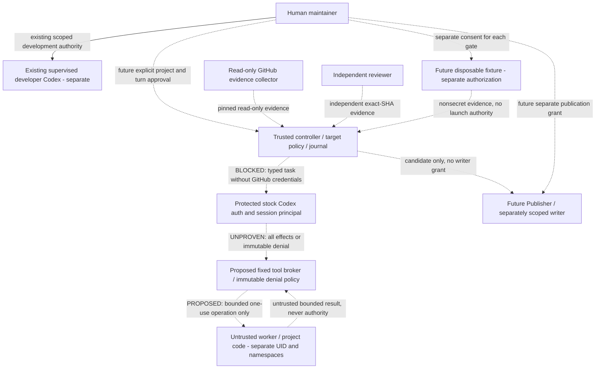

# ADR 005: stock Codex runtime feasibility — Issue #64

**AP-NF/1 · 2026-11-04 · ARCHITECTURE_REDESIGN_REQUIRED.** Runtime verdict remains
**NO-GO / SUBSCRIPTION_ISOLATION_BLOCKED / exit 13**. Stock Codex with ChatGPT
subscription funding remains the selected engine. No candidate is admitted.
The best research lead is a supported app-server/separate-executor contract,
subject to upstream clarification and a separately approved authority redesign.
This is not permission to change [ADR 003](subscription-transport.md)'s product selection or launch a fixture.

This decision extends [ADR 004](architecture-trust-boundaries.md) and compares,
without replacing, [AP-NS/1](native-security-go-no-go.md). Its bounded
[machine record](native-runtime-decision.json) is inert documentation: no runtime
loader, executable recipe, command, new provider or acceptance flag consumes it.
The existing supervised developer session is outside the product runtime design.

## Subject, freshness and reproducible source inspection

At inspection, official `openai/codex` **releases/latest** returned the latest
non-prerelease **0.166.0**, published **2026-10-29T19:47:53Z**. The annotated tag
`rust-v0.166.0` has object `593389380740f7b4762771573c447ccfdc59742f`, peeled to
commit **`6ff1e1ca3b30fc8b914720681fcf5fe62e95f856`**. Official main was separately
observed at `9ff072db8ae43d413c8d205ebf22b54b83c72cef`; it is not the release
subject or evidence of a stable interface. This snapshot makes no claim about
later releases, alpha/nightly builds, support duration or security certification.

Provenance: read the official [release API](https://api.github.com/repos/openai/codex/releases/latest),
[release page](https://github.com/openai/codex/releases/tag/rust-v0.166.0),
[tag ref](https://api.github.com/repos/openai/codex/git/ref/tags/rust-v0.166.0),
[tag object](https://api.github.com/repos/openai/codex/git/tags/593389380740f7b4762771573c447ccfdc59742f)
and [commit tree](https://api.github.com/repos/openai/codex/git/trees/6ff1e1ca3b30fc8b914720681fcf5fe62e95f856?recursive=1).
Resolve annotated tags until the object is a commit, require the complete tree,
then fetch text at that commit and recompute Git blob SHA-1
(`blob <byte length>\0<bytes>`) against the tree; also record SHA-256 and length.
The release notes mention standalone executor packaging and resume/fork fixes;
those are release observations, not proof of complete isolation.

Only public text was retrieved into a temporary cache. No downloaded code,
Codex binary, schema generator, help/version command, auth or app-server process
was executed. The ledger records selected inspected files and symbol locators;
it is a **partial static audit**, not all dependencies or transitive reachability.
Mutable official documentation was fetched as Markdown and hashed on this date;
its content can lead release code. Hashes correlate bytes, not author identity,
binary provenance or permission. Future reviewers must re-fetch exact pins,
inspect cited symbols and invalidate conclusions on drift. No binary was acquired:
current binary SHA, unpacked size, source equivalence and admission are UNKNOWN.
The 256 MiB runtime cap and separate historical inspection ceiling are unchanged.
The prior recorded developer version does not attest the current installed build.

Evidence classifications are claim-specific: **OFFICIAL_SUPPORTED** describes a
documented public operation, never its adequacy for our isolation requirement;
**EXPERIMENTAL** is explicitly gated/unstable; **RECORDED_HISTORICAL** is inherited
observation; **UNKNOWN** includes source mechanisms with no established supported
stock integration guarantee; **NOT_TESTED** means no execution observation here.
Source rows use UNKNOWN for support even when their text/hash was verified.

## Evidence matrix and current contract

| Evidence | Class | Established / limit |
| --- | --- | --- |
| D1 official [app-server](https://learn.chatgpt.com/docs/app-server) | OFFICIAL_SUPPORTED lifecycle; EXPERIMENTAL extensions | Documented threads/turns/approvals; dynamicTools/item-tool-call and environment selection are experimental. A callback for extra tools is not a total executor. |
| D2 official [authentication](https://learn.chatgpt.com/docs/auth) | OFFICIAL_SUPPORTED; eligibility UNKNOWN | ChatGPT subscription sign-in is documented, distinct from API billing. File/OS credential caching and automatic refresh require protection. This operator's plan/workspace/access was not checked. |
| D3 official [permissions](https://learn.chatgpt.com/docs/agent-approvals-security) | OFFICIAL_SUPPORTED | Command sandbox/approval controls exist; approval is not isolation. Read-only protected directories can still expose readable secrets. Not a proof of our complete boundary. |
| S1/S2/S3 current registry/dynamic handler | UNKNOWN supported total contract | Core, MCP, extension and dynamic runtimes are separate; dynamic callbacks remain a subset. |
| S4/S5/S6/S12 selected executor/filesystem | UNKNOWN total coverage | Separate executor and environment-aware patch routing are real source mechanisms. Selected local environments and other effects remain possible. |
| S7 host hook cwd | UNKNOWN complete disablement | Explicit host-run hook path prevents equating remote workspace with moving every effect. |
| S11 startup ToolPolicy | UNKNOWN stock accessibility | Rust ExtensionDataInit can install an immutable tool ceiling, require managed sandbox/unified exec, suppress additional permissions. It must be resupplied on resume; no reviewed stock CLI/RPC contract exposing the complete ceiling was established. Defaults are permissive. |
| S8/S14 nested Code Mode; S15 children | UNKNOWN boundary | Separate dispatch/child lifecycle must be covered even if a remote JS host exists. |
| AP-NS/1, ADR 002, AP-NCF/1 | RECORDED_HISTORICAL | 0.164.0 partial audit and reported Python kernel experiment; not rerun against 0.166.0. |
| Exact binary, kernel, actual stock tools, account/refresh | NOT_TESTED | G1–G3 NOT_RUN; source success cannot promote them. |

The machine record carries direct immutable URLs, Git blob IDs, SHA-256, lengths
and symbol locators for S1–S15 plus hashes of D1–D3. The former `/codex/security`
URL now describes a security scanning product; it is not used as sandbox evidence.
No SIWC/custom Responses transport, API-funded Agents API, enterprise token mode
or external-account forwarding is selected. New documentation describing those
products does not grant this project eligibility or change the engine decision.

### Immutable source index

- [S1 — codex-rs/core/src/tools/spec_plan.rs](https://raw.githubusercontent.com/openai/codex/6ff1e1ca3b30fc8b914720681fcf5fe62e95f856/codex-rs/core/src/tools/spec_plan.rs): build_tool_router; add_core_tool_sources; add_shell_tools; append_dynamic_tool_runtimes.
- [S2 — codex-rs/core/src/tools/registry.rs](https://raw.githubusercontent.com/openai/codex/6ff1e1ca3b30fc8b914720681fcf5fe62e95f856/codex-rs/core/src/tools/registry.rs): CoreToolRuntime; dispatch_any_with_state; pre/post hooks.
- [S3 — codex-rs/core/src/tools/handlers/dynamic.rs](https://raw.githubusercontent.com/openai/codex/6ff1e1ca3b30fc8b914720681fcf5fe62e95f856/codex-rs/core/src/tools/handlers/dynamic.rs): DynamicToolHandler; insert_pending_dynamic_tool.
- [S4 — codex-rs/core/src/tools/handlers/apply_patch.rs](https://raw.githubusercontent.com/openai/codex/6ff1e1ca3b30fc8b914720681fcf5fe62e95f856/codex-rs/core/src/tools/handlers/apply_patch.rs): ApplyPatchHandler; selected_executor; prepare_patch_request.
- [S5 — codex-rs/exec-server/README.md](https://raw.githubusercontent.com/openai/codex/6ff1e1ca3b30fc8b914720681fcf5fe62e95f856/codex-rs/exec-server/README.md): Authentication; Remote connections; Lifecycle; process/start; providerId.
- [S6 — codex-rs/core/src/environment_selection.rs](https://raw.githubusercontent.com/openai/codex/6ff1e1ca3b30fc8b914720681fcf5fe62e95f856/codex-rs/core/src/environment_selection.rs): default_thread_environment_requests; local_selection; local/remote shell snapshots.
- [S7 — codex-rs/core/src/hook_runtime.rs](https://raw.githubusercontent.com/openai/codex/6ff1e1ca3b30fc8b914720681fcf5fe62e95f856/codex-rs/core/src/hook_runtime.rs): tool_hook_cwd: hooks run on the host.
- [S8 — codex-rs/core/src/tools/code_mode/delegate.rs](https://raw.githubusercontent.com/openai/codex/6ff1e1ca3b30fc8b914720681fcf5fe62e95f856/codex-rs/core/src/tools/code_mode/delegate.rs): CodeModeDispatchBroker; CoreTurnHost; nested tool runtime.
- [S9 — codex-rs/login/src/auth/storage.rs](https://raw.githubusercontent.com/openai/codex/6ff1e1ca3b30fc8b914720681fcf5fe62e95f856/codex-rs/login/src/auth/storage.rs): get_auth_file; FileAuthStorage; DirectKeyringAuthStorage.
- [S10 — codex-rs/app-server-protocol/src/protocol/v2/thread.rs](https://raw.githubusercontent.com/openai/codex/6ff1e1ca3b30fc8b914720681fcf5fe62e95f856/codex-rs/app-server-protocol/src/protocol/v2/thread.rs): ThreadStartParams environments/dynamic_tools; resume/fork; disabled_plugin_ids.
- [S11 — codex-rs/ext/extension-api/src/tool_policy.rs](https://raw.githubusercontent.com/openai/codex/6ff1e1ca3b30fc8b914720681fcf5fe62e95f856/codex-rs/ext/extension-api/src/tool_policy.rs): ToolPolicy; ExtensionDataInit startup ceiling; resupply on resume.
- [S12 — codex-rs/app-server-protocol/src/protocol/v2/environment.rs](https://raw.githubusercontent.com/openai/codex/6ff1e1ca3b30fc8b914720681fcf5fe62e95f856/codex-rs/app-server-protocol/src/protocol/v2/environment.rs): EnvironmentAddParams; auth_bearer_token.
- [S13 — codex-rs/app-server/README.md](https://raw.githubusercontent.com/openai/codex/6ff1e1ca3b30fc8b914720681fcf5fe62e95f856/codex-rs/app-server/README.md): Current upstream interface notes; explicit-login startup reads.
- [S14 — codex-rs/core/src/tools/router.rs](https://raw.githubusercontent.com/openai/codex/6ff1e1ca3b30fc8b914720681fcf5fe62e95f856/codex-rs/core/src/tools/router.rs): ToolRouter; code_mode_tool_names; tool registration metrics.
- [S15 — codex-rs/core/src/tools/handlers/multi_agents.rs](https://raw.githubusercontent.com/openai/codex/6ff1e1ca3b30fc8b914720681fcf5fe62e95f856/codex-rs/core/src/tools/handlers/multi_agents.rs): Separate child-agent handler implementation.

## AP-NS/1 route delta (all enforced boundaries remain UNKNOWN)

Historical dispatch refers **only** to the experimental dynamic callback proposal.
Current facts do not prove that stock tools cannot operate in the auth domain.
Every row needs immutable denial or exclusively confined credential-free execution,
including all pre/post effects. Any newly found route is UNKNOWN and blocking.

| AP-NS/1 route | Historical callback | Current evidence / required closure |
| --- | --- | --- |
| dynamic_tools | SUPPORTED_SUBSET | EXPERIMENTAL; D1, S1, S3, S10. Extra callbacks remain separate registrations, not a universal replacement. |
| shell_exec | UNSUPPORTED | UNKNOWN; S1, S5, S6, S11. Unified exec or one-shot internal handler; managed startup ceiling exists in Rust, stock RPC access unestablished. |
| pty | UNSUPPORTED | UNKNOWN; S1, S5. Exec-server PTY and continuation exist; move all execution to worker or deny immutably. |
| write_stdin | UNSUPPORTED | UNKNOWN; S1, S5. Existing process input is a separate effect; bind process/epoch and revoke after cancel. |
| patch | UNSUPPORTED | UNKNOWN; S4, S6. Selected-environment filesystem routing is positive partial evidence; local selection/other patch paths need closure. |
| file_reads | UNKNOWN | UNKNOWN; S1, S6, S9. Image/resource/local and implicit reads are not universally substituted; deny auth read even in read-only mode. |
| file_mutations | UNKNOWN | UNKNOWN; S4, S5, S12. Filesystem RPCs are not model callback proofs; prevent effects in trusted auth filesystem. |
| mcp_connectors | UNSUPPORTED | UNKNOWN; S1, D1. MCP tools register separately; resources, auth/reload and server processes require disablement or confined ownership. |
| plugins_skills | UNKNOWN | UNKNOWN; S7, S10, S13. Selection/disabled plugin IDs do not prove complete installer, instruction or hook exclusion. |
| js_code_mode | UNKNOWN | UNKNOWN; S8, S14, D1. Nested dispatch and local/remote Code Mode host are distinct boundaries; remote JS host alone is insufficient. |
| hooks | UNKNOWN | UNKNOWN; S2, S7. Host-run hooks are explicit source counterevidence to remote workspace implying all effects moved. |
| background_children | UNKNOWN | UNKNOWN; S5, S8. Managed-process disconnect termination is documented; arbitrary descendants and retained sessions still need denial/liveness proof. |
| subagents | UNSUPPORTED | UNKNOWN; S1, S15, S10. Child config/environment/tool inheritance must retain the ceiling and auth principal boundary. |
| hosted_tools | UNKNOWN | UNKNOWN; S1, S14, D3. Hosted specs and network/app paths remain distinct from local executor isolation. |
| resume_fork_replay | UNKNOWN | EXPERIMENTAL; S10, S11, D1. Dynamic metadata restores on resume; internal ToolPolicy must be resupplied. No audited immutable cross-lifecycle inventory. |
| cancellation | UNKNOWN | UNKNOWN; S2, S5, S8. Cancellation tokens/managed-process termination are partial evidence, not whole-tree kill/reap or exactly-once proof. |
| credential_refresh_persistence | UNKNOWN | OFFICIAL_SUPPORTED; D2, S9. Cache/refresh is credential-owner work, outside tool callback model; live boundary not tested. |
| implicit_config_session_reads | UNKNOWN | UNKNOWN; S9, S13, S10. Startup config, AGENTS, plugin/session reads require trusted bootstrap and hostile input separation before turns. |
| remote_alternate_dispatch | UNKNOWN | EXPERIMENTAL; D1, S5, S12. Environment/direct process/fs/remote control ingress must be denied or authenticated; remote registration auth must not enter worker. |
| approvals_control_tools | UNKNOWN | OFFICIAL_SUPPORTED; D1, D3, S2. Approval grants/denials and user-input responses are not universal execution/result substitution or OS isolation. |

Current source improves the design vocabulary: startup tool ceilings, selected
filesystem/execution environments and executor lifecycle contracts deserve audit.
It does not establish that a stock protocol caller can close all authority.
ToolPolicy is an internal embedding facility, not demonstrated stock CLI policy;
using a custom harness/build to expose it would require a new product decision.
Hook denial/input rewriting is not universal effect substitution, and hooks can
execute code themselves. Names, model prompts, capability discovery, session IDs,
metadata thread/tool-call labels and same-UID private directories are not security
principals. A VM around credential-owning Codex cannot by itself protect credentials
from its own tools. Model-bound output can exfiltrate without direct worker Internet.

### Historical milestones retained without promotion

| Milestone | Inherited result / comparison |
| --- | --- |
| [#20 / ADR 002](tool-dispatch-feasibility.md) | 0.164.0 schemas and partial callback proof; current S1/S3 still distinguish dynamic and core handlers. No generated current schema or live callback handshake here. |
| [#24 / ADR 003](subscription-transport.md) | Stock CLI remains selected; historical SIWC/custom-engine proposals remain deferred. Candidate B below means native-auth app-server interface research, **not** approval of historical SIWC B or token forwarding. |
| [#26 canary](native-canary.md) | Separate fabricated-only helper and unchanged mandatory namespaces. It does not execute internal Codex tools. No new canary run. |
| [#28 / AP-NCF/1](native-linux-fixture.md) | Operator-reported sandbox01 worker/host PASS and same-domain FAIL; external scripts/manifest inputs still missing. Whole-VM confinement does not repair the inner boundary. |
| [#51 / AP-NS/1](native-security-go-no-go.md) | Historical 0.164.0 candidate was 308,139,304 bytes and exceeded 268,435,456-byte cap. Current binary size/equivalence is UNKNOWN, not inherited from that measurement. All 20 route boundaries remain unverified. |

## Candidate ranking and trust domains (design only)

| Rank / candidate | Subscription and boundary assessment | Decision |
| --- | --- | --- |
| 1 — B: official app-server with separately confined executor | Retains stock harness; native protected auth owner, fixed typed protocol to a different worker principal. Current environment/dynamic interfaces include experimental fields; host hooks, implicit reads, alternate APIs and stock ceiling remain unresolved. | Research priority only; ARCHITECTURE_REDESIGN_REQUIRED, not selected/admitted. |
| 2 — A: stock CLI with protected auth principal and constrained worker principal | Preferred product engine remains stock CLI. Requires supported complete routing or immutable disablement before hostile input, not a wrapper that launches all tools as auth UID. No supported exhaustive adapter demonstrated. | NO-GO; same-domain CLI-in-VM profile remains rejected. |
| 3 — C: explicit non-runnable stop | If complete supported contract is unavailable, retain supervised developer workflow and return product feasibility to maintainer. | Safe current fallback is no product execution. No custom inference runner/API/OAuth workaround. |

Dashed edges are proposed or blocked, not implemented integrations. The controller,
collector, publisher, reviewer and Codex account owner have distinct roles and
credential ownership. The worker receives neither GitHub/App clients/credentials
nor Codex credentials/session storage, controller state, reviewer authority or
publisher sockets. Any tool broker carries operation data, never OAuth. Only the
protected Codex principal owns subscription inference egress and refresh. The
publisher has no merge authority; human maintainer alone merges. Telegram has no
credentials or executable control edge. The developer's interactive credentials
and permissions are not reusable product authority.

## Required independently enforced OS boundary

These are future acceptance requirements, **not verified properties of flags**:

| Boundary | Required enforcement and negative evidence |
| --- | --- |
| UID/GID, memory, proc | Distinct nonprivileged auth/worker identities; no shared groups granting auth access. Separate PID/user/proc views, deny ptrace/process_vm/proc memory and parent fd/environ access. Map namespace IDs to actual host ownership; same-UID 0700 is insufficient. |
| Mounts, aliases, source | Auth home/native sessions/keyring/controller/Git common dir absent from worker mounts; immutable curated runtime, minimal proc/dev, only project worktree writable. Reject symlink/hardlink/bind/overlay aliases and host library/home fallback; project cannot alter bootstrap/config or approved source pin. |
| FDs and IPC | Explicit close-on-exec/allowlisted descriptor inheritance; no auth/lock sockets or descriptors in any child/PTY. Separate IPC and keyring/session buses; deny path and abstract Unix sockets, agent/DBus/keyring services and shared memory across principals. |
| Network and results | Worker net namespace denies direct egress and local services; broker has fixed authenticated peer/operation allowlist, no generic proxy. Codex inference egress only to approved account endpoints. MCP/hosted/network callbacks independently denied or confined; bound/redact model-bound output. |
| Process tree | NoNewPrivs, zero capabilities, reviewed seccomp, mandatory namespace policy and independently owned cgroup with bounded CPU/memory/PIDs/time/output. Kill/reap descendants on cancel, timeout, owner death/disconnect, including daemonization, PTY, hooks, nested cells and child agents. A terminal checkpoint is not proof of death. |
| Auth lifecycle | Only trusted owner reads/writes auth/session/refresh stores, including keyring fallback and rotation. Trusted immutable startup/config; no untrusted plugin/hook installation or account/provider changes. No token copied/mounted/proxied into a worker. |
| Host and broker | Verified disposable guest prerequisites, no shared host credentials/devices/sockets, no privileged fallback. Typed broker must bind project/build/operation/session/turn/worker/epoch, authenticate peers independently, reject duplicates/unknown tools before effects and retain uncertain intent. |

Residual channels include in-process file reads, auth-owner hooks/plugins,
unconstrained local environment selection, hosted tools, nested dispatch, session
poisoning, permitted output and trust in the credential-owner binary/dependencies.
OS confinement of one worker addresses none of those automatically. Mandatory
host controls missing means BLOCKED; never widen approvals, mounts or caps.

## Future verification proposal (not a task launch)

Within **10 working days / review by 2026-11-18**, the maintainer should request
upstream clarification of the four questions in the machine record. Audit whether
stock CLI/RPC exposes S11, which remote environment contracts are stable for
ChatGPT-subscription use, total disablement of host effects, and cancellation /
resume / refresh guarantees. Time-box the source/support review before proposing
expensive fixtures. No supported closure means retain NO-GO and ask the human
for a product architecture decision; never silently substitute another engine.
This document creates no Issue and starts neither #65 nor #60.

| Gate / separately authorized work | Required inputs and acceptance | Failure record |
| --- | --- | --- |
| G0 public static contract | Exact release/tag/commit/dependency audit; supported immutable inventory and authority closure for every route/implicit operation; exact binary/source provenance, unpacked closure and unchanged 256 MiB admission. This PR is PARTIAL_STATIC_ONLY. | UNKNOWN for any missing contract, new route, source/binary mismatch, oversized or unmeasured artifact. No fixture authorization from CI. |
| G1 disposable no-account kernel fixture | First obtain/review original #28 external build/audit scripts, raw manifest/inventory/logs, signed Debian/package lock, source/ISO inputs, Python/ELF closure and reproducible two-build result. Verify guest ownership/caps/namespaces, no NIC/host shares; separately approve build and each kernel experiment. | Preserve missing inputs as BLOCKED_MISSING_INPUTS. Reported sandbox01 host PASS / same-domain FAIL stays historical; dev01 is never the fixture. |
| G2 exact stock route/lifecycle mediation | Only after G0/G1 acceptance and separate scope: every route plus newly discovered paths uses fake assets and denied/control pairs through actual pinned stock routes. Verify fake auth/keyring/proc/FD/IPC/net isolation, immutable denial, nested/child paths, one-shot fallback, refresh mocks and kill/resume/reconnect. | A missing positive control, unavailable syscall, unknown worker, changed build/inventory, late response or surviving descendant is BLOCKED/NEEDS_HUMAN; no automatic replay/resume. |
| G3 live account E2E | Only after independent G0–G2 PASS and explicit separate login/refresh/per-paid-turn consent. Verify actual eligible account/workspace, safe native refresh/session persistence and exact-task recovery in the disposable environment. | AUTH_E2E_NOT_RUN until authorized. Quota prose/model output is not limit evidence; unknown outcome retains HOLD/NEEDS_HUMAN, no API fallback/account switch. |

G2 needs a separately reviewed fixture-only fake model transport or equivalent
upstream no-account test seam to drive actual stock handlers without authentication
or public inference. Directly testing executor RPCs alone cannot prove model route
coverage. If a stock build cannot exercise the relevant route without a real
account, that row stays NOT_TESTED and G2 blocks; do not silently move live work
into G2 or modify the product's provider/authentication configuration.

Future route probes retain AP-NS/1's 15-second outer budget, <=2 seconds per family,
<=64 KiB aggregate nonsecret output, owned-child reaping and explicit positive
controls. Wider lifecycle tests need separately reviewed bounds. Artifacts record
build/source/profile/inventory hashes, guest kernel/package identities, route and
operation/session/worker/epoch correlation, denial/control booleans, exit/timeout,
child-death acknowledgement and evidence class. Do not retain raw token-like
contents, home/session paths, commands, stderr or account data. Missing/redacted
provenance cannot be upgraded into PASS. Preserve uncertain state and edits;
rollback is quarantine, not automatic cleanup or repair.

## Conditional product handoff plan

After new authorization and gates, design a **versioned authority chain**, not a
conversion that strips [TargetProject](target-project-policy.md):

1. Trusted human/controller pins repo numeric/canonical identity, owner, branch,
   Issue/scope, source root, App registration and installation account, author /
   reviewers/check Apps, exact base/head and project authorization digest.
2. New project-aware admission/prepare/queue/checkpoint schemas carry these pins,
   installation/guard references and policy epochs end to end. Existing main-only
   preparation/queue receipt handoffs remain BLOCKED; no checkpoint migration or
   launch adapter is implemented here. Candidate nomination never grants execution.
3. Before any launch, revalidate fresh admission, local refs/root, collector
   evidence, human decision and mandatory isolation/build/inventory under the
   existing host-lock/durable-intent discipline. Pass bounded task data and opaque
   account/session references to the protected owner, never GitHub/App tokens.
4. Bind tool intent/result and native session UUID to project/turn/worker/epoch.
   HOLD/recovery remains explicit; recorded RUNNING is not liveness, missing HOLD
   is not release, cancellation uncertainty cannot authorize resume/replay.
5. Separate publisher authorization, independent exact-head review and human
   merge follow execution reconciliation. Review/CI/head/base drift invalidates
   authority; no automatic publication, Ready, Issue closure or merge.

The implementation prerequisite is independently reviewed supported mediation,
not a configurable exemption. Tests in this PR only validate the static decision
bundle's bounds, route completeness, source pins and non-enabling gate semantics.
They neither execute native probes nor authenticate evidence. Full local and
exact-HEAD hosted CI observations are recorded in the Draft PR, including known
dev01 failures. No offline PASS changes the mandatory NO-GO.
