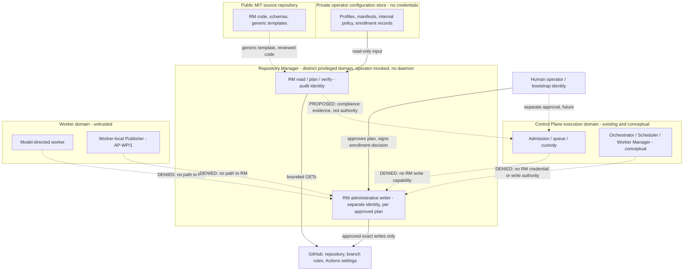
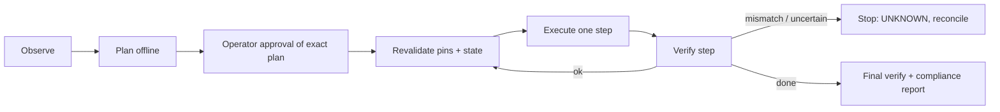
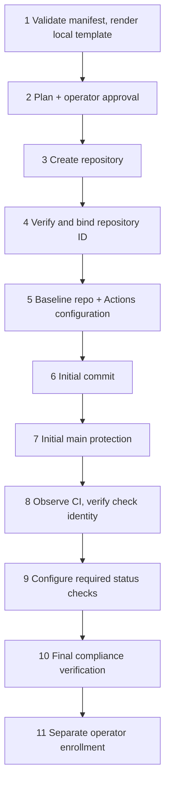

# ADR 012: Repository Manager architecture and administrative trust boundaries

Specification: **AP-RM/0.1**, Issue [#186](https://github.com/TechTradeExpress/Agent-Platform/issues/186)
(RM-01), 2026-11-24. Status: **PROPOSED / DESIGN_ONLY / SOURCE_ONLY / NO_LIVE /
HOST_NOT_RUN**, for independent review. Source baseline: `origin/main`
`48c14b47d5346e0d470da15f30bab787cbe8ff68`, observed by read-only fetch during
preparation. Issue text and remote snapshots describe scope, not authority.

This document introduces **Repository Manager (RM)** as a first-class
*administrative* component of the Agent Platform **Control Plane**, operating in a
distinct privileged security domain and independently invocable without a running
Control Plane daemon. It is not a separate product, not a third deployment role
and never a Worker feature. It adds no code, schema, CLI entrypoint, dependency, package, CI step or host change and
performs no GitHub, credential or provider interaction.

ADR 011 is reserved by [ADR 010](trusted-harness-invocation-no-go.md) (row FI-13)
for a future GO-state decision; this ADR therefore uses **012** to avoid a
conflicting identifier.

## 1. Evidence labels and unchanged barriers

Every statement is one of the following; the label is stated where it matters.

| Label | Meaning in this document |
| --- | --- |
| **APPROVED_DIRECTION** | Operator-approved architectural direction (Issue #186 and the RM-01 assignment). A direction, not an implementation or live capability. |
| **PROPOSED_INTERFACE** | Concept offered for independent review. Not a schema, API, loader or accepted wire format. |
| **UNRESOLVED** | Deliberately undecided; the decision criteria are named. |
| **ASSUMPTION** | Believed, not verified here; carries a future proof obligation (section 19). |
| **EXISTING** | Taken from a current document on `origin/main`; cited, not re-decided. |

Nothing in this document is IMPLEMENTED, authenticated, deployed, live-tested or
provider-supported. The evidence levels of [AP-TB/1](architecture-trust-boundaries.md)
(VERIFIED_OFFLINE, NOT_RUN, UNKNOWN, BLOCKED, REQUIRES_INDEPENDENT_REVIEW) apply.
Absent evidence is UNKNOWN or NOT_RUN, never PASS.

**Unchanged by this ADR (EXISTING):**

- `SUBSCRIPTION_ISOLATION_BLOCKED`, public `run`/`resume`/`doctor` quarantine and
  exit 13; `LIVE_NO_GO`; Gate #73 (operator governance/custody/live-identity gate).
- [AP-PKG/2](debian-role-package-architecture.md): exactly **two** Debian role
  packages (`agent-platform-control`, `agent-platform-worker`). No third package
  is accepted or introduced by this ADR; RM's intended home is the Control package
  only (section 11).
- [AP-TP/1](target-project-policy.md) target-project pins, receipts and
  UNKNOWN-journal rules; this ADR does not extend AP-TP/1 receipts (section 14).
- [AP-SM/2](solo-maintainer-policy.md): **only the human maintainer merges**;
  no automatic Ready, Issue closure, admission, publication or merge.
- [ADR 006](worker-pool-identity-architecture.md) worker-specific identities and
  [ADR 008](multi-harness-architecture.md) one active harness per worker.
- Root [AGENTS.md](../AGENTS.md): supervised-development authority never
  transfers to product components, and RM is a product-side concept, not a
  contributor-workflow feature.

## 2. Decision (APPROVED_DIRECTION)

1. Agent Platform gains a **first-class Control Plane administrative component,
   Repository Manager**, intended to belong to the future `agent-platform-control`
   package and **never** to the Worker package. Its sole purpose is to create,
   bootstrap, inspect and bring into compliance the *GitHub repositories that Agent Platform may later manage as
   downstream projects*.
2. RM is **operator-invoked**, **offline-first**, **fail-closed** and invocable
   **without a running Control Plane daemon**, worker or Publisher. Its proposed
   CLI namespace is `agent-platform-control repo` (section 7).
3. RM is part of the Control Plane *product* but is **logically and operationally
   separated** from the worker runtime, the Publisher and the Control Plane's
   execution authority (section 4): it runs in a **distinct privileged security
   domain**. The Orchestrator, Scheduler and Worker Manager do **not** inherit RM
   credentials or write authority. RM itself never executes tasks, publishes
   candidate work, reviews PRs, merges, or admits a project to execution.
   Administrative changes require explicit operator approval.
4. **Creation of new repositories is a core MVP capability** (APPROVED_DIRECTION,
   operator-approved). The credential mechanism, bootstrap authorization and the
   division between automated and manual operator steps are **UNRESOLVED**
   (section 18, U5). GitHub is the **only MVP provider**. Provider abstraction is limited to what
   the MVP needs; no other forge is designed here.
5. Public source holds generic templates and contracts; private operator
   configuration holds profiles, manifests, internal policy and enrollment
   records. Credentials live in neither (section 5).
6. Administrative and development credentials are different principals with no
   shared custody (section 6).
7. RM produces *compliance evidence*. The Control Plane may consume *verified*
   evidence as an input to project admission and task authorization, but evidence
   is never authorization (section 14).

### Explicit non-goals

RM is not: a scheduler, daemon, webhook receiver, merge bot, review bot,
ruleset-by-default-writer, secret manager, GitHub App factory, token minter,
organization-membership manager, multi-provider framework, replacement for
`docs/github-governance.md` operator steps, or a Terraform/OpenTofu distribution.
RM does not provision hosts, install packages, register or install Apps, change
visibility/billing, or alter any repository in this ADR's scope. It grants no
worker or Publisher a new capability, and it does not weaken `LIVE_NO_GO`.

## 3. Relationship to existing components

| Component | Relationship to RM (all PROPOSED unless EXISTING) |
| --- | --- |
| Control Plane ([CP-01](control-plane-host-contract.md), [CP-02](github-app-publisher-contract.md)) | RM is a first-class Control Plane component in a **distinct privileged security domain** (APPROVED_DIRECTION). It shares the product and, in future, the Control package, but not credentials, principals, state or IPC with other Control components. A *future* admission design may consume verified RM compliance evidence for project admission and task authorization (section 14). |
| Orchestrator, Scheduler, Worker Manager (conceptual Control Plane roles; none implemented as such here) | **Must not** inherit RM credentials, handles or write authority, and cannot invoke RM writes. They may only consume evidence as data under section 14. |
| Worker / Publisher (AP-WP/1, [PUB-02](draft-publisher.md)) | Untrusted with respect to RM. Workers receive **no repository administration capability**. No RM credential, handle, socket, IPC or configuration-writing capability exists on any worker or Publisher path. |
| Read-only collector ([#49](github-evidence.md)) | Separate read principal for runtime evidence. RM may share *code-level* read patterns in a future implementation but not credentials or processes. |
| Supervised contributor (`agentdev`, Codex/Claude Code) | Remains a developer principal. RM's *development* (RM-02..RM-11) is ordinary supervised source work and gives the contributor no administrative rights. |
| Independent reviewer / human maintainer | Unchanged. RM does not review or merge. |
| Operator human | Sole principal who authorizes RM write operations and enrollment. |

## 4. Administrative trust boundaries and responsibility map

Dashed arrows are proposals or denials, never launch authorization. The boxes are
logical responsibilities, not existing services or security containers.

### Responsibility and trust-boundary table

| Domain | Responsibility | Trust assumption | Must never |
| --- | --- | --- | --- |
| Human operator | Decides what to manage, approves each plan and enrollment, holds bootstrap authority | Root of authority; direct decision, not model output | Delegate approval to a model, Issue text or a receipt hash |
| RM read/plan/verify (audit identity) | Reads GitHub state, computes desired-vs-actual, reports compliance, verifies after change | Trusted code, read-only credential, untrusted GitHub *content* | Write to GitHub; treat repository content as instructions |
| RM administrative writer | Applies one operator-approved plan, step by step, with revalidation | Separate principal, short-lived, per-plan | Run without a current approved plan; act on worker/Publisher request; hold wider scope than the plan |
| Private configuration store | Holds operator-controlled desired-state inputs | Integrity-protected, operator-owned, **no secrets** | Be writable by a worker, Publisher or the RM writer itself |
| Public source | Generic templates and reviewed code | Public, reviewed by normal source workflow | Contain org/repo identifiers, internal policy, credentials or tokens |
| Control Plane execution components (admission, queue, custody; conceptual Orchestrator, Scheduler, Worker Manager) | Execution admission and custody (EXISTING) | Existing contracts | Inherit or hold RM credentials, handles or write authority; invoke RM writes; accept RM evidence as authorization |
| Worker / Publisher | Untrusted task work and one-shot Draft publication (EXISTING) | Hostile code and descendants | Reach RM credentials, config-writing, admin IPC or general GitHub write |

## 5. Public source versus private operator configuration (APPROVED_DIRECTION)

| Class | Location | Contents | Prohibited contents |
| --- | --- | --- | --- |
| Public MIT source | This repository | RM code, schemas, **generic** repository templates (README/CONTRIBUTING/CI skeleton, `.gitignore`, license placeholder), documented safe defaults, test fixtures with fabricated values | Real owner/repo IDs, internal policy, enrollment records, hostnames, key paths, tokens, any credential |
| Private operator profile | Operator-controlled private store (location UNRESOLVED) | Desired-state profiles, repository manifests, internal policies, enrollment records, identity pins (section 8), approved-operation allowlists | Credentials, App keys, tokens, signer handles |
| Credential custody | Outside both repositories (section 6) | Credentials only | Anything not required to authenticate |

**Invariants (PROPOSED):**

- A profile or manifest is **data**, validated against a closed, versioned schema
  with unknown fields rejected; it never carries commands, hooks or code.
- Configuration is read from an explicit operator-supplied path. There is no
  auto-discovery, no default repository and no configuration fetched from the
  target repository itself (consistent with AP-TP/1: no tenant-file loader).
- The private configuration store is not writable by the RM writer, worker,
  Publisher or Control Plane runtime. Changes to it are operator edits, reviewed
  by the operator's own process.
- Public templates are *inputs to a plan*, not applied unreviewed; a rendered
  template result is shown in the plan before any write.
- Mixing is detected: a public-source change that adds a real repository identity
  or secret-like value is a defect to be caught by the RM-05 template checks. The detection
  design is UNRESOLVED.

## 6. Separation of administrative and development credentials

Four identities with distinct trust domains. The matrix is a **requirement for
future implementation**, not a statement that any identity exists.

| Identity | Purpose | Allowed (PROPOSED) | Denied |
| --- | --- | --- | --- |
| Human / bootstrap | Create the first repository and approve plans; initial ownership | Interactive operator-authenticated actions outside RM code paths | Being embedded in RM, a worker or a config file |
| RM audit (read) | Read-only inspection and compliance verification | Bounded GET endpoints on pinned repositories; no mutation | Any write, any broader repository set than pinned |
| RM administrative writer | Apply an approved plan | Only the exact operations in one approved, unexpired plan, on the pinned repository | General GitHub client; operations absent from the plan; destructive remediation; use outside plan lifetime |
| Worker / Publisher (EXISTING, ADR 006/AP-WP/1) | Task work and per-worker App Draft publication | As already contracted | Any RM credential, handle, admin IPC or configuration-writing capability |

Rules:

1. **No shared custody.** The four identities use different credentials, stores
   and processes. A development credential must never double as an administrative
   one, and vice versa.
2. **No administrative credential, signer handle, general write client, admin
   IPC or configuration-writing capability** exists in any worker, Publisher or
   runtime path, **nor is inherited by the Orchestrator, Scheduler or Worker
   Manager** (APPROVED_DIRECTION). Being in the same product or package grants
   none of it.
3. Credentials stay outside both the public source and the private configuration
   repository. RM code obtains them only through an operator-controlled channel
   whose design is UNRESOLVED (section 18, U3). Same-UID `0700` directories and
   environment filtering are **not** an isolation boundary (EXISTING, AP-TB/1).
4. Administrative-writer credentials are short-lived and scoped to one repository
   where the provider permits. **Repository creation is an exception in kind:** a
   repository that does not yet exist cannot be the scope of its own creation
   credential, so creation needs an owner-level (account or organization)
   permission that is broader than any later per-repository grant (ASSUMPTION,
   to be verified). That broader capability must be used for the creation step
   only, never reused for later configuration or by development identities, and
   its custody mechanism is UNRESOLVED (U5/U3). Whether GitHub permits the required narrowness for
   each operation is an ASSUMPTION to verify (section 19); if not, the operation
   is UNSUPPORTED, not performed with a broader token.
5. Administrative operations that cannot be expressed with a scoped, auditable
   credential remain **manual operator steps**, documented as in
   [github-governance.md](github-governance.md).
6. GitHub cannot distinguish human intent from credential possession. RM does not
   claim that human-only merge or human-only administration is *enforced* by
   documentation or by credential separation (section 12).

## 7. Operator-invoked standalone CLI concept (PROPOSED_INTERFACE)

An administrative CLI under the proposed namespace **`agent-platform-control
repo`** (APPROVED_DIRECTION for the namespace; the exact subcommand names below
are PROPOSED and deferred). It is a future command of the Control package and
registers **nothing** now. It is **not** exposed by the Worker package or by the
existing `agent-platform` developer entrypoint, and it is invoked directly by the
operator, never by the Orchestrator, Scheduler, Worker Manager or a worker.
Adding it to the Control package will require a separately reviewed amendment of
the closed ADR 007 command and module manifests (section 11); that amendment is
not made here.

| Concept | Behavior |
| --- | --- |
| `inspect` | Read-only. Observes actual state of a pinned repository; emits desired/actual diff and capability results. No writes. |
| `plan` | Offline. Combines profile + observed state into an exact, ordered, reviewable plan. Writes nothing to GitHub. |
| `apply` | Operator-approved only. Executes an approved plan step by step with revalidation, including repository creation and bootstrap steps (section 10); stops on any unexpected state. |
| `verify` | Read-only. Post-change check producing a compliance result. |
| `enroll` (record) | Records a separate operator decision to treat the repository as an Agent Platform project. Does **not** admit it to execution. |

Properties: usable with no Control Plane running; no daemon, scheduler or webhook;
bounded time/output/pagination; fixed endpoint allowlist; all repository content
and API replies treated as untrusted data; deterministic, redacted output with no
credential or raw-error leakage; non-zero fail-closed exit on UNSUPPORTED,
UNVERIFIED or contradictory evidence. Existing `run`/`resume`/`doctor` exit-13
quarantine is untouched, and RM must not be reachable through those commands.
Until the manifest amendment is reviewed and merged, RM has no Debian presence;
a source-only or developer-run form is permissible for RM-02..RM-07 (section 11).

## 8. State model, identity pins and results (PROPOSED_INTERFACE)

### Desired and actual state

*Desired state* is the operator's validated profile plus manifest. *Actual state*
is a bounded, timestamped observation from GitHub. RM reasons only over their
explicit, typed comparison; it never infers desired state from the repository.

### Identity pins

Identity binding has two phases (consistent with AP-TP/1: compare numeric ID **and**
full name). A repository that does not yet exist **cannot have a pinned repository
ID**, so a plan for a new repository must not pretend to carry one.

**Pre-creation pins (known before the repository exists):**

- Provider (`github`) and the **explicit owner identity**: owner numeric ID, login
  and type (Organization or User), pinned by the operator and verified by a
  read-only lookup. The owner is never inferred from the credential's default
  account, a redirect, or configuration fetched from the target.
- Intended repository name, visibility, default branch name and approved
  administrative scope.
- The operator authorization reference for this plan (never obtained from a
  repository, an Issue or model output).
- A unique plan/creation intent identifier recorded before the effect (section 9).

**Post-creation binding (established only after verified creation):**

- Canonical **repository numeric ID** and full name, read back from the provider
  after creation, and checked against the pre-creation pins: owner ID/login/type,
  name, visibility and default branch. Any mismatch stops the run.
- The verified repository ID is then recorded as an immutable binding and becomes
  a required pin for **every** later step. No later write is authorized on a name
  match alone; a response body from the creation call is not itself verification.

**Existing repositories** (designation rather than creation) require the full pin
set including repository ID from the start.

A name match alone, a redirect, a renamed or transferred repository, or an
identical repository name under another owner has no authority. A pin mismatch
aborts before any write. A rename/transfer requires fresh operator pins.

### Capability and compliance results

Per check the result set is closed:

| Result | Meaning |
| --- | --- |
| `COMPLIANT` | Observed state matches desired state under fresh, complete evidence |
| `NONCOMPLIANT` | Observed state differs; remediation may be planned |
| `UNSUPPORTED` | **Affirmative evidence** establishes a provider or plan limitation: the control cannot be expressed or exposed for this pinned repository (for example, a feature documented and independently corroborated as unavailable for its visibility and plan) |
| `UNVERIFIED` | The control could not be observed or the cause is not established: ambiguous HTTP 403 or 404, missing permission, rate limit, incomplete pagination or observation, transport or server error |
| `CONTRADICTORY` | Observations conflict or drift during the read |

**Classification rule (fail-closed).** An ambiguous HTTP 403, a 404 (which can mean
"absent" or "not visible to this credential"), a missing permission or an
incomplete observation is `UNVERIFIED`, never `UNSUPPORTED`. A provider message
alone is not sufficient. `UNSUPPORTED` requires independent evidence of the actual
limitation, for example authoritative reads of the repository's visibility and
owner plan facts combined with pinned, reviewed provider documentation for the
same endpoint and version, recorded with source and observation time. If that
evidence is absent or conflicting, the result stays `UNVERIFIED`.

`UNSUPPORTED` and `UNVERIFIED` are **never** promoted to `COMPLIANT`, and an
unreadable setting is not a successful empty one (EXISTING, github-governance.md:
the observed 403 on protection/rulesets is UNKNOWN, not "no protection").
Overall compliance is the *meet* of its parts: any non-`COMPLIANT` blocking
control yields an overall non-compliant result.

## 9. Operation lifecycle: plan, approval, revalidation, verification

Rules (PROPOSED, fail-closed):

1. **Plan is not authority.** A plan is an immutable, digest-bound description.
   Approval is a separate authenticated operator action bound to the exact plan,
   repository pins and an expiry. A model or RM itself cannot approve.
2. **Revalidate before each effect.** Reread pins and the specific state the step
   depends on immediately before it; any drift stops the run (AP-TB/1:
   freshness is transition-local, no magic TTL).
3. **Fail-closed operation ownership.** RM acts only on objects it can prove it
   created or that the plan names explicitly. It never adopts, modifies or
   deletes repository settings, branches, rules or files it does not own by
   explicit plan entry. Ambiguous ownership stops the step.
4. **No destructive remediation.** No deletion, force-push, history rewrite,
   visibility change, ownership transfer, permission broadening or disabling of
   protection is performed by RM in MVP. Such actions are manual operator steps.
5. **Persist intent before effect.** Record intent durably before each write;
   an uncertain outcome (timeout, 5xx, lost response) is `UNKNOWN`, reconciled by
   bounded read-only inspection, **never blindly replayed** (EXISTING pattern
   from AP-TP/1 and the Publisher contract). The journal design is UNRESOLVED.
6. **Partial failure.** On a failed or uncertain step RM stops, reports completed
   steps accurately, retains evidence and requires a fresh plan or operator
   reconciliation. It never rolls back automatically, retries destructively or
   reports an unverified step as done.
7. **Verify after change.** Each effect is confirmed by an independent read; the
   final report is a fresh compliance result, not an echo of the write response.

## 10. Repository creation, bootstrap and compliance lifecycle (PROPOSED)

Repository creation is an MVP capability (section 2). The lifecycle below is
ordered and fail-closed. No stage implies the next; in particular **bootstrap is
not enrollment and enrollment is not admission**. Every effect is subject to the
section 9 rules (plan, approval, revalidation, intent-before-effect, verification).

| Stage | Description | Authority | Output / stop condition |
| --- | --- | --- | --- |
| 1. Manifest validation and local rendering | Validate the private manifest against its closed schema; render the generic public template **locally**; operator reviews the rendered result. No network write. | Operator | Validated manifest digest, rendered files; reject unknown fields or secret-like/identifier leakage |
| 2. Plan and approval | Generate the exact ordered plan (creation, baseline, commit, protection, check configuration) bound to pre-creation pins; the operator approves the exact digest. Steps depending on values unknown until later stages (repository ID, check App identity) are declared as **binding points** with explicit acceptance rules. | Operator (explicit approval) | Approved plan digest with expiry; no approval, no write |
| 3. Repository creation | Fail-closed name availability check, then one creation effect under the explicit owner (below). | Administrative writer, approved plan | Intent recorded first; outcome verified in stage 4, not trusted from the response |
| 4. Verification and ID binding | Read back the created repository; verify owner ID/login/type, name, visibility, default branch; record the repository ID binding (section 8). | Audit identity | Binding record, or STOP (`UNKNOWN`/mismatch) |
| 5. Baseline configuration | Apply and verify baseline repository settings and Actions permissions from the approved plan (for example default workflow token permission, disabled auto-merge; exact controls from the manifest). Observe collaborators, installed Apps and deploy keys; unobservable means `UNVERIFIED`. | Administrative writer, approved plan; audit verification | Per-control results |
| 6. Initial commit | Deliver the reviewed rendered template as the initial commit by the mechanism fixed in the plan (mechanism UNRESOLVED; section 18, U5). Verify commit SHA and tree against the reviewed render. | Administrative writer or operator, per plan | Commit SHA; mismatch stops |
| 7. Initial main protection | Apply the minimal protection that does not depend on yet-unknown check identities (for example no force-push, no deletion, pull-request requirement where the plan and provider support it) and verify it. Unavailable or unreadable controls stay `UNSUPPORTED`/`UNVERIFIED` (section 8) and block progress to enrollment. | Administrative writer, approved plan; audit verification | Per-control results |
| 8. CI observation and check identity | Observe the workflow run read-only and verify the check **name and GitHub App identity** (not display name) against the manifest's pinned expectation. | Audit identity | Verified check identity, or `UNVERIFIED` |
| 9. Required status checks | Configure the required status check using the verified identity from stage 8 and verify the effective rule. | Administrative writer, approved plan (binding point); audit verification | Effective rule observed |
| 10. Final compliance verification | Fresh, complete, pinned read of every control; report all results with limits. | Audit identity | Compliance evidence artifact, time-stamped |
| 11. Project enrollment | **Separate**, explicitly operator-approved decision recording that this repository is an Agent Platform project, bound to the verified repository ID and the stage 10 evidence. | Human operator | Enrollment record (private configuration) |

Admission of the project to execution is a **later, separate** Control Plane
decision (section 14); it is not a stage of this lifecycle.

### Development-agent access during bootstrap

No development agent, worker, Publisher or per-worker App has write access to the
new repository at any stage up to and including stage 10. Such access is a separate
operator decision, taken only after stage 10 shows the required governance as
verified (not `UNVERIFIED`/`UNSUPPORTED`) and authorized by its own explicit
approval. Stage 5 observation of collaborators, Apps and deploy keys exists to
detect unintended writers. Because `main` is unprotected between stage 6 and
stage 7, only the administrative writer and the human operator may hold write
access in that window; any other observed writer, or an unobservable writer list,
stops the run before stage 6.

### Fail-closed creation (stage 3)

- **Explicit owner identity.** Creation names the pinned owner (ID, login, type).
  It never defaults to the credential's own account. Endpoint and permission
  differences between User and Organization owners are an ASSUMPTION to verify.
- **Name availability check.** Only an affirmative, authoritative observation that
  the name is absent under the pinned owner permits creation. A 404, 403, redirect,
  rename trail, rate limit, incomplete read or any ambiguous result is
  `UNVERIFIED` and blocks (a 404 may mean "not visible to this credential").
- **No adoption.** If a repository of that name already exists, the creation plan
  stops; it never adopts, configures or overwrites it. Designating an existing
  repository is a different flow requiring the full pin set (section 8).
- **Race handling.** The check is advisory. The creation effect itself must fail
  rather than overwrite on a name collision (ASSUMPTION about provider behavior);
  a collision or error is reported, never retried blindly or "repaired".
- **Uncertain outcome reconciliation.** After a timeout, 5xx or lost response, RM
  records `UNKNOWN`, does not recreate, and reconciles by bounded read-only lookup
  by owner and name. A repository found is **not assumed to be RM's**: provenance
  must be established against the recorded intent (owner, name, visibility, plan
  digest and creation-window evidence, and an expected pristine state). If
  provenance cannot be established, the result stays `UNKNOWN` for operator
  reconciliation; RM never deletes, renames or takes over the repository, and a
  fresh plan is required before any further effect.

### Compliance lifecycle

Results are time-stamped observations. They expire in practice at the next drift
check; there is no TTL that makes old facts safe (AP-TB/1). Re-verification is
required before any future dependent decision and after any repository transfer,
rename, permission or ruleset change. Continuous drift detection and enforcement
is a later milestone (RM-11).

**No automatic admission, privilege escalation or destructive remediation** occurs
at any stage. A noncompliant result produces a plan proposal only.

## 11. Component placement and the two-package decision

**EXISTING:** AP-PKG/2 specifies exactly two Debian role packages and closed
command/module manifests (Control P0: 32 modules; Worker P0: four modules).

**APPROVED_DIRECTION (operator refinement of RM-01):**

- RM is intended to belong to the **future `agent-platform-control` package** and
  its proposed command is `agent-platform-control repo`.
- RM is **never** included in the `agent-platform-worker` package: no RM module,
  command, template, configuration or credential path in any Worker payload,
  including P1. Worker-side import of RM code is a defect.
- **No additional Debian role package** is introduced; a third package is a
  closed non-decision.

This ADR **does not** modify any manifest, `debian/` file, builder, module closure
(C/W lists), command inventory, `pyproject.toml`, deployment configuration or
existing executable interface. It records intent only.

**Explicit conflict and deferral (not silently resolved):** ADR 007 currently
freezes Control P0 as exactly 32 named modules with the single command
`/usr/bin/agent-platform-control`, and states that no new CLI exposes private
APIs. Adding `repo` subcommands and RM modules therefore **requires a separately
reviewed, human-merged amendment** of ADR 007 (a later Issue, RM-08) that adds the
exact module names, command surface and file ownership as a new closed phase.
Until then RM has no Debian presence and no host installation.

**Constraints on that future amendment (PROPOSED, to preserve separation inside a
shared package):**

| Constraint | Reason |
| --- | --- |
| Distinct privileged principal(s) and state directory for RM, e.g. separate from `ap-admission`, `ap-custody`, `ap-signer`; names and IDs are UNRESOLVED and not assigned here | Co-packaging must not become shared credentials or a shared secret-bearing UID |
| No administrative credential, App key, token or private organization configuration in dpkg payload or conffiles | Section 5/6 |
| RM modules not imported by Orchestrator, Scheduler, Worker Manager, admission, custody or signer code; imports one-directional and reviewed | Co-location in one package is not a privilege boundary |
| RM command runnable without any Control Plane daemon, socket or IPC peer | Independent invocation |
| Private root-owned source readability grants no RM authority | Same rule as ADR 007 Control closure |
| Package lifecycle (install, upgrade, remove, purge) never creates, adopts, repairs or deletes RM credentials, plans, journals or enrollment records | Protected state is not dpkg payload |

Rejected as directions: placing RM in the Worker package (worker domain must hold
no administrative capability); a third `agent-platform-repository-manager` role
package; a shared common/secret-bearing library package (rejected by ADR 007).

## 12. GitHub governance constraints and assumptions

All items are **ASSUMPTIONS** requiring later verification (section 19). They are
not claims about the live repository.

- **GitHub Free public vs private.** Branch protection and rulesets availability
  depends on visibility and plan. [github-governance.md](github-governance.md)
  recorded 403 responses for the protection/ruleset endpoints on a private
  repository and treated enforcement as UNVERIFIED. Whether the same holds for a
  given downstream repository and plan is unverified. A control returning 403 is
  `UNVERIFIED` unless independent evidence establishes the limitation (then
  `UNSUPPORTED`; section 8), never "protected" and never silently "unsupported".
- **Solo-maintainer review problem.** With one human, a formal independent human
  APPROVE may be impossible; AP-SM/2 documents the delegated technical-review
  model and its limits. RM must not pretend a second human reviewer exists or that
  a required-approval rule is satisfied by an AI COMMENT.
- **Human-only merge is not technically enforced by documentation.** GitHub does
  not distinguish human intent from the credential used. RM does not claim to
  enforce human-only merge; it can only *report* observed merge restrictions,
  bypass actors and permissions, and mark absent enforcement as a residual risk.
- **Least-privilege granularity.** Contents write is repository-wide, not
  feature-branch scoped, and PR write is broader than Draft/COMMENT (EXISTING,
  CP-02). Whether administrative operations can be granted narrowly enough is
  unverified; if not, the operation is manual.
- **Documentation URLs and API behavior** may change; each future check pins the
  exact endpoint, version and observation time rather than relying on this text.

## 13. Native REST versus optional OpenTofu/GitHub provider backend

**Decision for this ADR: no backend is adopted and no dependency is added.**
(APPROVED_DIRECTION: compare; UNRESOLVED: choose.)

| Criterion | Bounded native REST (Python, in-tree) | OpenTofu + GitHub provider (optional) |
| --- | --- | --- |
| New dependencies | None beyond existing standard library/pinned client discipline | External binary, provider plugin, state backend; supply-chain surface |
| Offline plan / determinism | Fully controllable, fixture-testable | Plan engine exists; provider drift and version pinning needed |
| Credential exposure | One narrow code path, fixed allowlist, redacted output | Provider and state may hold or log sensitive values; state file is sensitive |
| State and reconciliation | RM must build its own journal and ownership tracking | Built-in state, but state loss/drift and import semantics are risks; fail-closed ownership must still be added |
| Coverage of GitHub settings | Only what is implemented; unsupported controls explicit | Broad, but coverage depends on provider version and may exceed the approved scope |
| Auditability / review | Small reviewable surface | Large third-party surface; hard to bound to allowlist |
| Destructive-change risk | Excluded by construction (no delete ops) | Plans can include destroy/replace; must be blocked by policy |
| Host/packaging impact | In-tree, no new package | New binary requires acquisition, pinning and host provisioning |
| Portability to other providers | None (GitHub only) | Multi-provider ecosystem (not an MVP goal) |

**Decision criteria for a later offline/read-only feasibility spike (RM-03
candidate)**, to be executed only after separate authorization and never against
a live repository without separate approval:

1. Can every OpenTofu-planned operation be mapped to the RM allowlist, with
   destroy/replace blocked deterministically?
2. Can the provider run with a read-only credential for planning and keep state
   free of secrets and out of the public/private config repositories?
3. Is the provider/tool acquisition pinned and verifiable without a third
   package or install-time download (consistent with AP-PKG/2)?
4. Does the result add clear coverage over native REST for controls the MVP
   needs, or only complexity?
5. Can ownership and drift be made fail-closed (explicit import of named objects
   only)?

Default if the spike is inconclusive: **native REST remains the MVP backend**.
Selecting OpenTofu requires its own ADR, dependency review and operator approval.

## 14. Future Control Plane admission integration (PROPOSED, not authorized)

RM may in future emit **verified compliance evidence** that Control Plane
admission and task-authorization designs *consume as one input*. Constraints (APPROVED_DIRECTION for semantics,
PROPOSED for shape):

- Evidence is **not authorization**. Compliance does not admit a project, grant a
  credential, assign work or permit publication. Admission remains a separate
  Control Plane decision with human authorization.
- Evidence is a new, separately versioned conceptual envelope. It does **not**
  extend, reuse or modify **AP-TP/1 receipts** or AP-TB/1 envelopes.
- Required envelope content (conceptual): issuer/provenance, repository ID and
  full name, owner pins, observed state digest, per-control results from the
  closed set in section 8, RM and policy revision, observation time, and the
  operator enrollment reference.
- **Freshness and revalidation:** a consumer must reread/revalidate immediately
  before each future assignment or publication; stale evidence is rejected.
- **Unknown or contradictory evidence blocks.** `UNVERIFIED`, `UNSUPPORTED`,
  `CONTRADICTORY`, missing or incomplete evidence never counts as compliance.
- Evidence delivery must authenticate the issuing principal; a file loaded from
  the target repository must never bootstrap that trust (AP-TB/1).
- **Project admission and task authorization** are the two intended consumption
  points. In both, verified compliance is a *necessary input at most*; the
  Control Plane's own admission policy, the operator's separate enrollment
  decision and existing AP-TP/1 / AP-TB/1 gates remain the authority.
- The consuming Control Plane components (Orchestrator, Scheduler, Worker
  Manager) read evidence **as data only**; reading it confers no RM credential or
  write authority.
- Integration requires a separately reviewed Control Plane Issue and does not
  depend on current Publisher or packaging milestones.

## 15. Safety invariants (summary, PROPOSED)

1. Default deny; missing, stale, changing or contradictory evidence blocks.
2. Explicit repository and owner identity pins on numeric ID and name.
3. RM write requires a current, exact, operator-approved plan; plan is not
   authority.
4. No credential in public source, private configuration or logs.
5. Administrative and development credentials are never shared.
6. No admin capability reachable from worker, Publisher or runtime paths.
7. No destructive remediation, no automatic admission, publication or merge.
8. Intent persisted before effect; uncertain outcomes reconciled read-only,
   never replayed blindly.
9. `UNSUPPORTED`/`UNVERIFIED` are never promoted to `COMPLIANT`.
10. Documentation does not claim enforcement that GitHub does not provide.

## 16. Threat considerations (non-exhaustive, PROPOSED)

| Threat | Boundary | Required mitigation (future) |
| --- | --- | --- |
| Prompt injection via repository/Issue/API content | Untrusted GitHub data to RM | Treat all as data; closed schemas; no command interpolation |
| Rename/transfer/lookalike repository | Identity | Numeric ID + name + owner pins; abort on mismatch |
| Admin credential theft from worker path | Credential domains | No RM credential reachable by worker/Publisher; OS-enforced separation proven separately |
| Plan substitution / TOCTOU | Plan vs apply | Digest-bound approval; revalidate before each effect |
| Over-broad token | Credential scope | Operation-to-permission mapping; refuse if not narrowly grantable |
| Private config tampering | Config store | Operator-only writable; integrity check design UNRESOLVED |
| Uncertain write replay | Effects | Intent journal; read-only reconciliation |
| Creation under wrong owner, name collision or adoption of a foreign repository | Repository creation | Explicit owner pins, affirmative name-absence check, no adoption, post-creation ID binding, provenance-checked reconciliation (section 10) |
| Unprotected window or unintended writers during bootstrap | Initial commit before protection | No development-agent write access; writer observation; unobservable writers stop the run (section 10) |
| Evidence mistaken for authorization | Control Plane | Distinct envelope, freshness, fail-closed consumer |
| Scope creep to destructive actions | RM behavior | No destructive ops in MVP; manual operator steps |
| Provider backend supply chain | OpenTofu option | Spike criteria; no adoption without ADR and pinning |

## 17. Staged roadmap RM-01 .. RM-11 (PROPOSED)

The roadmap leads to a functional MVP. **RM-09 is the first functional MVP
milestone** (a verified repository bootstrap against disposable repositories, then
the TTE Bench pilot). RM-10 and RM-11 are subsequent integration milestones.

**This roadmap grants no authority.** Each stage is a separate, operator-assigned
Issue with its own independent review. Every future implementation, packaging,
host and live-validation step requires separately scoped approval; none starts
automatically; none depends on current Publisher, Control Plane or packaging
milestones; none authorizes live GitHub access, credential use, repository
creation or host change without its own explicit approval.

| Stage | Scope | Gate / evidence |
| --- | --- | --- |
| RM-01 | Architecture and security boundaries (this ADR) | Independent review; documentation only |
| RM-02 | Declarative configuration model: closed offline schemas for profile, manifest, desired/actual state, results, pre-/post-creation identity pins and enrollment records; validators; private/public configuration separation; fabricated fixtures | VERIFIED_OFFLINE only |
| RM-03 | Backend feasibility: offline/read-only spike of native REST vs OpenTofu against the section 13 criteria; no adoption | Written findings; separate authorization for any tool run |
| RM-04 | Read-only inspection and audit: fixed-allowlist inspector, compliance classification incl. the `UNSUPPORTED`/`UNVERIFIED` rule, name-availability observation | Offline tests; live reads NOT_RUN until authorized |
| RM-05 | Offline plan and template rendering: plan engine with digest binding and binding points; local template rendering; public-source leakage lint | Offline tests |
| RM-06 | Administrative writer and approval contract: approval binding, intent journal, creation and partial-failure recovery, credential custody and the automated/manual split (U3, U5), writer principal design | Independent security review; no live credential |
| RM-07 | Controlled apply and repository bootstrap implementation: stages 1-10 of section 10 implemented and tested against fakes | Offline tests; live effects NOT_RUN |
| RM-08 | Control CLI and package integration: `agent-platform-control repo` and the ADR 007 amendment adding RM to the **Control** package only (exact modules, command, distinct principal/state); no Worker, no third package | Independent review; maintainer approval; human merge |
| RM-09 | Disposable repository validation and TTE Bench pilot: first live bootstrap on disposable repositories, then the operator-approved pilot | Separate live approval, explicit pins, independent review of evidence; **first functional MVP milestone** |
| RM-10 | Control Plane admission integration: evidence envelope and consumer rules (section 14) | Independent review; no admission authority by itself |
| RM-11 | Drift detection and enforcement: scheduled or on-demand drift reports and operator-approved remediation plans | Independent review; no automatic destructive remediation |

**TTE Bench** is the future pilot repository for RM-09, subject to operator
approval. Its identity, ownership, visibility and plan are UNVERIFIED here and no
access was performed. The pilot needs its own Issue, explicit operator pins, a
disposable-first approach and separate live-evidence approval. It is not scheduled
and depends on none of the current Publisher or packaging milestones.

## 18. Unresolved decisions

| ID | Question | Decision criteria / owner |
| --- | --- | --- |
| U1 | Exact `repo` subcommand names and the ADR 007 Control manifest amendment (placement in Control is decided; wording is not) | RM-08; maintainer; AP-PKG/2 constraint |
| U1a | Distinct RM principal/UID, state paths and IPC (if any) inside the Control role | RM-06/RM-08; CP-01 host contract; independent security review |
| U2 | Private configuration store form, integrity and location | RM-02/RM-05; operator |
| U3 | Credential delivery channel for audit and writer identities | RM-06; independent security review |
| U4 | Native REST vs OpenTofu backend | RM-03 spike criteria |
| U5 | For repository creation (an approved MVP capability): the credential mechanism for owner-level creation, bootstrap authorization (including the initial-commit mechanism) and the division between automated and manual operator steps | RM-06; operator; independent security review |
| U6 | Intent journal design and independent anchor | RM-06; reuse of AP-AJ/AP-TP patterns to be evaluated |
| U7 | Exact GitHub plan/visibility constraints per target | Read-only verification; section 19 |
| U8 | Evidence envelope fields, signing and delivery | RM-10; Control Plane design |
| U9 | Secret/identifier leakage detection mechanism for public templates | RM-05 |
| U10 | Relationship to open gates #73, #99, #108, #130, #168, #169, #179, #183 | Context only; no dependency or activation authority |

## 19. Future verification requirements (NOT_RUN)

No item below was performed for this ADR.

| Area | Status | Proof obligation |
| --- | --- | --- |
| Live GitHub reads and settings behavior | NOT_RUN | Authenticated read-only snapshot with pinned identity, time and endpoints |
| GitHub plan/visibility effect on protection and rulesets | NOT_RUN / ASSUMPTION | Per-target observation, including 403 classification |
| Credential narrowness for administrative operations, including owner-level creation | NOT_RUN / ASSUMPTION | Official-API permission mapping and effective-grant observation |
| Repository creation, name-availability semantics, collision behavior and uncertain-outcome reconciliation | NOT_RUN / ASSUMPTION | Disposable-repository validation (RM-09) with explicit owner pins |
| Bootstrap ordering window (initial commit before main protection) and observability of collaborators/Apps/deploy keys | NOT_RUN / ASSUMPTION | Disposable-repository validation (RM-09) |
| Credential custody and OS-level principal separation | NOT_RUN | Real negative probes across actual boundaries (AP-TB/1 standard) |
| Absence of RM capability on worker/Publisher paths | NOT_RUN | Negative tests once an implementation exists |
| OpenTofu/provider feasibility | NOT_RUN | RM-03 spike |
| `UNSUPPORTED` evidence for plan/visibility limits | NOT_RUN | Independent evidence per section 8 for each claimed limitation |
| Packaging placement under AP-PKG/2 | NOT_RUN | Manifest and closure review without a third package |
| Control Plane evidence consumption | NOT_RUN | Separate design and review |
| TTE Bench identity and pilot suitability | NOT_RUN | Operator pins and read-only verification |
| Human-only merge enforcement | NOT_RUN / ASSUMPTION | Server-side rule observation; documentation never proves it |

## 20. Consistency check against existing decisions

| Existing decision | This ADR |
| --- | --- |
| AP-TB/1 trust domains, fail-closed freshness, evidence levels | Applied; RM is an additional *administrative* domain, adds no runtime authority |
| AP-TP/1 explicit pins, no tenant auto-discovery, no AP-TP/1 receipt extension | Preserved (sections 5, 8, 14) |
| CP-02 per-worker Apps, operation/permission matrix, no worker admin | Preserved; RM identities are separate from worker Apps |
| github-governance.md observed 403, UNVERIFIED enforcement, no administrative mutation | Preserved and generalized (section 12) |
| AP-SM/2 solo-maintainer review, human-only merge | Preserved; no enforcement claim |
| AP-PKG/2 exactly two packages | Preserved; RM targets the Control package only, never Worker, no third package. Conflict with ADR 007's closed Control P0 manifest is explicit and deferred to a reviewed amendment (section 11) |
| ADR 006/008 worker-specific identities and one harness | Preserved; no RM mapping to worker/harness |
| Root AGENTS.md and exit 13 / LIVE_NO_GO / Gate #73 | Unchanged |

No conflict with a current document was found. Deferred decisions are listed in
section 18; if a later reading finds a conflict, the more restrictive rule
applies and the operator decides (root AGENTS.md section 8).

## 21. Independent reviewer checklist

- Confirm the diff is exactly one new Markdown file and changes no code, schema,
  dependency, package manifest, CI, `AGENTS.md` or other active contract.
- Confirm no claim of implemented, authenticated, deployed, live-tested or
  provider-supported capability; ASSUMPTION and NOT_RUN items are labelled.
- Confirm exactly two Debian role packages remain, RM is intended for Control only
  and never Worker, and the ADR 007 manifest conflict is stated, not hidden; `AP-TP/1`, human-only merge,
  worker-specific identities, `SUBSCRIPTION_ISOLATION_BLOCKED` / exit 13,
  `LIVE_NO_GO` and Gate #73 are unchanged.
- Confirm administrative and development credentials are separated and that no
  administrative capability is placed on worker, Publisher or runtime paths.
- Confirm repository creation is an MVP capability with unresolved credential
  mechanism and automated/manual split, that pre-creation identity and
  post-creation repository ID binding are distinct, and that the 11-stage
  bootstrap keeps development-agent write access unavailable until governance is
  verified and separately authorized.
- Confirm `UNSUPPORTED` requires affirmative evidence and ambiguous 403/404 stays
  `UNVERIFIED`; confirm the RM-01..RM-11 roadmap grants no authority.
- Confirm evidence is never equated with authorization and that unknown or
  contradictory evidence blocks.
- Check all relative links resolve and the exact HEAD, base and CI of the delivery.
- This ADR performs no self-review; the implementing agent is not the reviewer.
