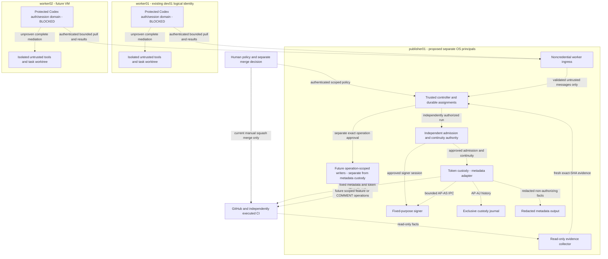
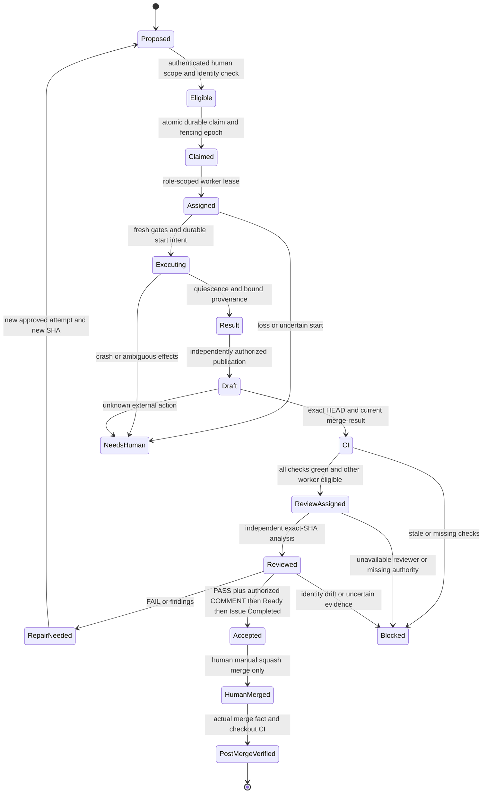

# Architecture v0.1: symmetric worker pool and identity boundaries

ADR 006 / **AP-WP/0.1**, Issue #82, 2026-11-08.
**DESIGN_ONLY / NO_HOST_CHANGE**. This is Agent Platform; Diatonic Orchestrator
is a separate, unrelated project. This ADR approves a design direction, not a
running system, host inventory attestation, executable schema or grant of authority.
Source baseline independently verified during preparation:
`365a15b0f590ffb20d273c79f0086892f812680a`.

## Decision and alternatives

Design `publisher01` as a trusted Control Plane and `worker01` / `worker02` as
symmetric, mutually isolated execution VMs on the shared Proxmox host `pve01`.
Existing `dev01` may retain its physical hostname while using logical pool ID
`worker01`; worker02 is a future VM with physical hostname undecided. No machine
is renamed, created, cloned, inspected remotely or configured by this milestone.

Either worker can implement or independently review **different** assignments.
Do not infer role or authorization from hostname, IP, bot name or queue position.
Initially permit at most one active Codex job per VM; initial rollout executes
pool jobs sequentially until resource and isolation gates justify concurrency.
The current source contributor workflow remains one supervised Issue/worktree/PR
at a time. This diagram describes future interfaces, all blocked today:

No worker-to-worker edge exists. Ingress has no direct signer/custody handle.
The protected Codex auth owner is conceptually separate from model-directed tools
**inside each VM**. Putting all Codex processes in a VM does not solve that inner
boundary. See [ADR 005 / AP-NF/1](native-runtime-feasibility.md): complete stock
tool mediation, credential separation, immutable startup and lifecycle remain
unproven. Native and legacy public execution remain **BLOCKED / exit 13**.

Rejected options: fixed dev/review host roles lose interchangeability and do not
prove independence; two bot installations of one App do not create distinct App
actors; shared worker home/template secrets destroy identity separation; direct
worker write tokens or a generic controller proxy expose excessive authority.
Two VMs are chosen for process separation, not availability or independent humans.
A compromised hypervisor/root administrator can affect every VM and credential.
There is no HA or independent failure domain on one physical host.

## What exists versus what is proposed

| Capability | Current evidence / status | Required before activation |
| --- | --- | --- |
| Supervised source delivery and review | IMPLEMENTED human-invoked workflow, [AP-SM/2](solo-maintainer-policy.md) | Fresh scoped human instruction; exact-SHA gates for each review action |
| Assignment / App identity | AP-CA/1 advice and AP-CI/1 **VERIFIED_OFFLINE_FIXTURE**; no durable claim | Authenticated controller, project-aware lifecycle and fresh authoritative identities |
| Metadata observer | AP-AM/1 metadata-only facts, no App-attributed action proof | Separately authorized trusted-host observation; no promotion to writer evidence |
| MVP.8d / AP-AL/1 | Inactive bounded wire/token lifecycle libraries, offline tests | Signer/custody/host wiring and independent approval; no enabled client |
| MVP.8e / AP-AJ/1 | Exclusive SQLite journal, local commit/lock/crash tests | External continuity producer, storage/restore/reboot assurance; no independent anti-rollback proof |
| MVP.8f / AP-AS/1 | Genuine fixed RS256 and bounded injected-socket handlers, disposable-key tests | Trusted admission/replay producer, key provisioning and principal isolation; legacy Claims-only bridge BLOCKED |
| Existing App | Operator-reported `techtradeexpress-agent[bot]`, **Metadata read only** | Fresh evidence before any use; not a coding writer or reviewer |
| Pool / ingress / enrollment / distributed leases | **NOT_IMPLEMENTED** | New reviewed interfaces, durable protocol and OS/network evidence |
| Per-worker Apps / restricted writers / scheduler | **DESIGNED, NOT_IMPLEMENTED** | Separately authorized provisioning and permission/governance gates |
| Native workers / live pool E2E / autonomy | **BLOCKED / NOT_RUN** | All native gates plus separately approved staged E2E; no paid fallback |

This inventory does not supersede [AP-TB/1](architecture-trust-boundaries.md),
[AP-AL/1](app-api-adapter.md), [AP-AJ/1](custody-journal-and-host-isolation.md),
[AP-AS/1](app-signer-ipc.md), [AP-CI/1](coding-app-gate-b.md) or
[AP-CA/1](codex-assignment.md). Their schemas, bounds and unsupported handoffs are
unchanged. No new parallel authorization framework is implemented by this ADR.

## Identity model and immutable assignments

| Identity | Proposed binding and ownership | Never infer from |
| --- | --- | --- |
| Machine | Controller-enrolled logical worker ID, unique machine identity and boot/enrollment epoch, independently pinned certificate identity and runtime image digest | Hostname/IP alone, copied machine-id or possession of a task file |
| Agent | Logical implement/review agent ID and independent provenance; new isolated context for every role assignment | GitHub bot login or a model's claim of being reviewer |
| Execution | Unique attempt/execution ID, exact native session UUID if admitted, worker/boot epoch and checkpoint generation | Most recent session, PID alone or a free lock |
| Task authority | Authenticated human/controller authorization reference, immutable job/assignment digest, role, scope, expiry and fencing generation | Issue/labels/model PASS, signed transport alone or repository policy text |
| GitHub posting | Actual API-observed App ID, bot numeric ID/login, installation/account, repo ID, permission snapshot, token expiry and operation authorization | Slug, public Bot profile, machine identity or key possession alone |

Proposed assignment envelope binds schema/version; canonical repo ID/full name,
owner/account IDs; Issue ID/number and authorized scope/revision; unique job ID;
role; assigned machine/agent IDs; assignment generation, nonce, issued/expiry;
base branch/ref and full base SHA; exact PR ID/number and full HEAD SHA when a PR
exists; source/worktree identity; policy/admission reference; intended App and
installation; runtime/toolchain/model/config digests; allowed operations and
budgets. IDs/digests correlate evidence, not authenticate the approving principal.
Before a PR exists, retain a typed pre-PR phase with no invented PR/HEAD; bind its
created commit and actual PR later through a new approved immutable phase record.

Reuse AP-CA/1, TargetProject/InstallationIdentity, admission, queue, status and
recovery primitives after separately reviewing required versioned extensions.
Existing main-only queue/checkpoint conversions and target handoffs remain blocked;
never strip project pins to fit an old type. This ADR defines no accepted wire
schema or migration. Authorization provenance must originate outside target files,
worker messages, Issue contents, labels, reports and model output.

### Role selection and anti-self-review

Controller records the full contribution set: implementation agent/execution,
machine and context lineage, actual PR author and all later contributing attempts.
Select a reviewer on the **other worker**, with a fresh session/worktree and no
implementation transcript, writable implementation checkout or shared CODEX_HOME.
The reviewer obtains the canonical diff, commits, CI and findings independently.
Implementer summaries can be labelled supplementary untrusted input, never proof.

Reject reviewer identities belonging to any contributor, reused implementation
sessions, swapped role fields, reassignment back to a contributing worker, or a
posting bot matching the actual PR author. If both workers contribute to the same
candidate, no eligible pool reviewer remains: BLOCKED pending a separately
approved independent review process. A reviewer who edits the candidate becomes
a contributor; a new SHA needs a new eligible review. Rename/role/App rotation
cannot erase contributor lineage or unresolved intents.

For another task, worker02 may implement and worker01 review. Machine switching
alone does not prove independent reasoning; shared accounts/models may share
failure modes. This is AI-assisted technical review, never two independent humans.
One human may maintain, author and authorize the project. The implementer cannot
accept its own review, fabricate PASS/APPROVE or authorize its own GitHub action.

## GitHub identities, minimal permissions and attribution

Proposed, **unregistered illustrative names**: `agent-platform-worker01[bot]` and
`agent-platform-worker02[bot]`, each from a distinct App with distinct App/bot and
installation pins. Role is per task, not permanently attached to either App.
AP-CA/1's coding/reviewer identities remain distinct for each assignment even
when the role mapping reverses on a later task. The existing metadata-only App is
not upgraded or reused as a writer. Registration owner and target repository owner
are separate facts; selected installation membership must match the target.

The following is a **future permission candidate matrix**, not deployed grants.
Endpoint-specific minimums must be independently verified during provisioning;
if unavailable or unsupported, BLOCK rather than broaden permissions. No worker
receives installation tokens, PEM/JWTs, a signer socket or unrestricted proxy.
All credentials stay in separately authorized controller-side custody; writer
principals are separate from the existing metadata adapter and from ingress.

| Operation | Minimum candidate repository permission | Credential owner and authorization gate |
| --- | --- | --- |
| Read repo / Issue | Metadata read; Issues read for private Issue data | Separate read collector; pinned repo/Issue, bounded GETs |
| Fetch source / exact diff / PR | Contents read and Pull requests read as required | Read collector/sanitized immutable transfer; Git does not execute target hooks/config |
| Verify checks / Actions checkout / threads | Checks read, Actions read, Commit statuses read and Pull requests read as required; Contents read for commit lineage | #49 collector, expected check App IDs, full pagination and actual checkout/merge-parent evidence |
| Push isolated feature branch | Contents write, selected repository only | Future coding publisher using assigned worker App; exact approved ref/tree/parent and durable intent; never a token in worker |
| Create Draft PR | Pull requests write | Coding publisher under the same exact target/task authority; validate actual PR author and association |
| Post findings / technical COMMENT | Pull requests write for review COMMENT; Issues write only if a separately approved Issue-comment operation needs it | Distinct reviewer publisher, exact immutable report/payload, independent human approval and durable journal; #59 remains COMMENT-only |
| Ready transition | Pull requests write, subject to separately verified API requirements | Separate source supervised reviewer authority under AP-SM/2; no product capability currently implemented |
| Linked Issue Completed | Issues write | Separate, narrowly authorized source transition; not bundled into the coding App's minimal writer profile |
| Merge Agent Platform main | No worker/App merge grant | Human maintainer only, current governance and exact reviewed evidence; no automatic merge |

Contents write is repository-wide, **not feature-branch scoped**. Pull requests
write also exposes more than COMMENT. Fixed server-side action validation and
verified branch governance/no bypass must constrain future writers before live
GO. Deny main/default/release writes, force pushes, APPROVE, ruleset/workflow or
permission mutations and model-selected destinations. If enforcement cannot
prevent main writes, the future writer is NO-GO. Do not add Issues write to the
historical minimal coding profile merely to combine operations. Whether separate
writer Apps are additionally needed to reduce its permission union is a D-stage
review decision, not implied authorization to register more Apps now.

The controller records original submitting machine/agent/execution separately
from the API-observed commit/PR/review actor. It never claims a human or reviewer
posted merely because it mediated the request. Review publication uses the
assigned reviewer App, not the implementer's. Validate the real PR author after
creation; a commit author field is forgeable and not equivalent to that identity.
A privileged key or valid transport certificate proves neither human approval
nor independent analysis. Pin complete fresh App/installation/repo/permissions/
expiry evidence and distinguish custody assertions from GitHub metadata and
verified App-attributed actions; public Bot data cannot fill missing proof.

Source development continues [AP-SM/2](solo-maintainer-policy.md): Codex delivers
Draft; human-requested ChatGPT independently reviews exact HEAD and all gates;
its current same-account COMMENT is labelled AI-assisted/same actor, not a #49
identity-qualified Receipt or formal APPROVE. Authorized reviewer performs
COMMENT, revalidate, Ready, revalidate, linked Issue Completed; only the human
merges main. This ADR does not replace that workflow with unattended worker
reviews. Downstream mutations still require target-specific workflow and explicit
authenticated human approval of the exact immutable AP-CH/1 payload. A future
feature-branch auto-merge product is deferred, not approved here.

Pool Codex review reports are proposed technical-analysis inputs, not substitutes
for today's separately requested ChatGPT source review or AP-CH/1's approved
ChatGPT handoff. Any new review-engine/handoff integration needs its own explicit
contract review and human authorization; do not relabel Codex output as ChatGPT
evidence or fabricate a compatible product Receipt.

## Control Plane compartments and administrative boundary

| Domain / proposed separate OS principal | Allowed boundary | Explicit denial |
| --- | --- | --- |
| Worker-facing ingress | Narrow authenticated enrollment/task-bound pull/status/result messages, strict schema/size/deadline/rate checks; validated records to controller | No key, token, controller DB write, journal FD, signer/custody socket, SQL/shell or generic method/HTTP proxy |
| Trusted controller | Installed reviewed code, policy/claim/lease records, independent evidence validation, approved action dispatch | No repository code execution, Codex CLI, model tools or trusting worker PASS as authorization |
| Admission / external continuity authority | Authenticated exact-run approvals, one-use/fencing records and independent anchor advancement | No self-issued approval from custody or restoration of an old DB/anchor as fresh authority |
| Signer | AP-AS/1 fixed RS256, admitted sessions and exact peer/key/App pins | No network, arbitrary PEM path or payload, worker ingress, generic signing endpoint or default Authority |
| Metadata custody | Owns AP-AM observe and AP-AL injected clients; fixed token lifecycle and approved signer IPC | No untrusted project execution or review analysis; never export Adapter, JWT/token/lease/DB objects |
| Journal | AP-AJ explicit namespace/store/anchor, full-session exclusive lock, rollback/EXTRA; private custody storage | No worker access, implicit initialization/repair, eviction, UNKNOWN reset or local anti-rollback claim |
| Metadata output | Validated redacted non-authorizing Result only | No token, key, journal path, client/FD or approval capability |
| Future GitHub writer(s) | Separately approved fixed operation, independent journal and exact destination | No shared metadata privilege, generic worker endpoint, merge or self-authorization |
| Human / host administrator | Separately authorized management through approved VPN/SSH, trusted binaries/enrollment/restore decisions | Never treat model suggestions as admin authority; no management credentials in any task/image/log |

These are trust domains, not an assertion that UIDs/services exist. Ingress must
be a different process/UID/network listener from signer/custody/controller; no
shared credential or inherited handle crosses into it. Controller validates
untrusted ingress records again. Inter-compartment IPC is fixed-purpose and
peer-authenticated; this is not direct access from the worker to signer/custody.
SO_PEERCRED authenticates a kernel snapshot, not a human, executable image or
persistent process lineage. LoadCredential delivers a copy readable by its unit
UID; it is not process isolation. Root/hypervisor administrators remain trusted.

Backup/restore can roll back assignments, replay state and anchors together.
Local SQLite, hashes, fsync and VM snapshots cannot independently attest deletion
or rollback resistance or survive a malicious custody UID. Independent continuity,
storage flush/power-loss evidence and operator incident authority are mandatory.
Signer admission producer and safe AP-AL Claims-only bridge remain NOT_IMPLEMENTED;
this architecture supplies neither and never uses a permissive fallback.

## Default-deny communications and authenticated pull

Zones below are **proposed examples**, not current networks, addresses or rules:
management, worker01, worker02, noncredential ingress, protected control/custody,
and restricted external egress. No IP/subnet, bridge or VLAN allocation is assumed.

| Source -> destination | Proposed policy | Evidence required before GO |
| --- | --- | --- |
| worker01 <-> worker02 | DENY both directions, all protocols and address families | Negative probes including same-bridge/L2 and IPv6 paths |
| Either worker -> signer/custody/journal/controller private ports, Proxmox or private infrastructure | DENY; includes management, local/link-local services, storage, Docker/agent sockets and credential APIs | Deny/control tests from actual untrusted task UID and namespaces, not only VM shell |
| Worker trusted agent -> noncredential ingress | Only fixed enrolled mTLS endpoint; bounded assignment pull, acknowledgement, status and result types | Server pin, unique per-machine cert, boot/task/role/generation binding, expiry/revocation/replay tests; no task tool access to enrollment key |
| Ingress -> controller | Narrow validated message transfer across separate OS principals | Independent controller revalidation; no generic dispatch or credential/socket forwarding |
| Untrusted tools -> external network | DENY direct egress | DNS/IP/redirect/proxy/tunnel and model-output exfiltration controls |
| Trusted reader / protected Codex owner -> GitHub / OpenAI | Explicit reviewed endpoints only, verified TLS and bounded transport; account auth only in protected domain | Endpoint/support and credential-boundary audit, denied alternates; no API-billed fallback |
| VM -> DNS / NTP | Only approved resolver/time service from necessary trusted principal | Block arbitrary DNS, alternate DoH/DoT, rogue time and IPv6 bypass; stale/untrusted time blocks admission |
| Admin -> VMs / hypervisor | Existing approved VPN/SSH management path only, independently authorized | No worker-origin management path or shared SSH agent/key; no management changes in this ADR |
| Any unsolicited inbound -> workers | DENY; replies only to allowed initiated flows | Stateful firewall/reboot tests; no controller SSH requirement for job delivery |

Worker communication is pull-based: authenticate machine enrollment, ask for one
role-bound assignment, then acknowledge its exact generation before execution.
The future trusted agent verifies controller identity and task authorization;
transport authentication alone never authorizes a turn or publication. Controller
authenticates results as claims from that worker, then verifies Git/CI/approval
facts independently. Bound request bodies, polling frequency, connection counts,
result sizes and TTLs; propose one outstanding pull and one assignment per worker,
<=64 KiB messages and <=5-second exchanges for future protocol review. Not a
new implemented protocol; AP-AS/1 retains its stricter 2/8 KiB limits.

A guest firewall alone is insufficient against a compromised guest. Review
hypervisor and guest firewall backend/precedence, bridge forwarding and L2
adjacency; VLAN tags alone are not access policy. Apply default deny to IPv4 and
IPv6, link-local/multicast/neighbor paths and inter-VM bridges, not only routed
traffic. Anti-spoof enrollment addresses/certificates independently. Reject IP
literal, alternate DNS, redirect and proxy bypass. Domain allowlists must handle
GitHub delivery domains and changing OpenAI endpoints without broad Internet
access. A constrained egress proxy can enforce/audit destinations but introduces
a trusted component and tunnel/exfiltration risks; do not assume TLS interception
or arbitrary CONNECT is safe. Exact endpoint and firewall design is a C-stage
gate requiring real negative tests. No live network probe is authorized here.

## Provisioning, Codex parity and conditional resource budget

Both VMs need the same reviewed Debian-based image/toolchain: system release,
architecture, kernel isolation features, Git/gh/Python/uv/Ruff/pytest/dependencies,
package provenance and exact stock Codex artifact/source/config inventory. Reuse
the established Debian 13 candidate lifecycle, not an untested package install on
the development host. Pin compatible versions and compare measured manifests
before assignment; unknown/drifting versions quarantine the worker. Model/effort
selection must use separately verified supported Codex settings and approved
account policy; this ADR supplies no new flags, model choice or inference route.
No Codex install/login/probe is performed here.

Use a reproducible clean system/software-only template, never an unsanitized clone
of a logged-in dev VM. Exclude CODEX_HOME, tokens/auth/keyring/session/transcripts,
SSH host/client keys and known_hosts, machine-id, enrollment certs, GitHub identity,
worktrees, user homes/secrets, task/controller state, journal/anchors and restore
snapshots containing them. Provision unique identities afresh under later human
authorization. A sanitize checklist is not proof: inspect the image offline and
perform negative recovery tests before cloning; failed sanitation means reject it.

Each worker has separate protected CODEX_HOME/account authentication and session
state, private task worktrees and no shared writable caches, keys, mounts or agent
sockets. Trusted bootstrap must exclude target-controlled hooks, plugins, config
and implicit startup paths from the auth domain. Read-only review worktrees still
contain hostile code; tests run only in the isolated tool domain. Follow the full
[AP-NF/1 route/lifecycle audit](native-runtime-feasibility.md), including proc/FD,
ptrace, hooks, nested tools/agents, refresh and kill/reap. Same UID/private files or
a whole-VM boundary are insufficient. Account ownership/eligibility and supported
subscription behavior must be verified separately; separate sessions/machines do
not prove independent quota. Unknown limits cause HOLD, never automatic account
switch, paid fallback or guessed reset/resume.

The reported host context is Ryzen 5 PRO 4650G, **16 GiB RAM / 1 TB NVMe**.
These are planning inputs, not measured allocations/free capacity. Illustrative
starting envelope **only if operator measurements support it**:

| Allocation | Conditional planning envelope | Admission constraint |
| --- | --- | --- |
| Host and existing workloads | Reserve at least 4 GiB plus measured existing peak needs | Real free RAM/swap pressure and host management/storage safety take priority |
| publisher01 compartments | Approximately 2 GiB, 1–2 vCPU, 20–40 GiB disk | Measure journal fsync latency and memory; no project tests or Codex workload |
| Each worker | Approximately 4 GiB, 2 vCPU, 40–80 GiB disk | Initially one active job pool-wide; heavy suites may require more RAM/disk and remain BLOCKED |
| Remaining capacity | Nominal 2 GiB before additional workloads/reserves | This is not proof that both workers fit; no admission by arithmetic alone |

Before provisioning measure CPU peak/overcommit, available RAM and swap-in/OOM,
other VM allocations, NVMe free space/wear/latency, snapshots/backups and test peak
RSS/disk/PIDs/output. vCPU reservations do not create physical cores. Do not use
swap as credential-safe capacity; review dumps/swap policy. Plan per-job cgroup
CPU/memory/PID/time/output/disk quotas and process-tree death supervision before
launch. Existing lifecycle caps stay unchanged; a bigger VM is not a cap waiver.

Use staged tested security updates and immutable image/version manifests; drain
and quarantine drifted workers rather than update mid-job or restore sessions
silently. Define maintenance windows, rollback/re-enrollment with new boot epochs,
package lifecycle tests and secret revocation/rotation procedures. No unattended
update or reboot may start queued work automatically. Backups need encryption,
access separation and external continuity reconciliation; they are not HA.

## Durable role-neutral workflow and review evidence

Both implement and review assignments must use the same isolated role-neutral
launch/checkpoint discipline; the diagram expands the review allocation stage
without implying a privileged reviewer execution shortcut.

The following is a future state machine, not a change to current checkpoint
phases, host mutexes or native gates:

`Executing` is unreachable today through Agent Platform (exit 13). Claims must
be committed atomically against canonical repo/Issue/job and expected generation;
two workers contending get one winner, never two allowances. Persist assignment
intent before delivery, require matching acknowledgement, and retain all lease
and revocation records. Use independently authenticated fencing generations on
every result and proposed effect. Lease expiry is **not** proof a child died or
an external operation did not occur; do not transfer execution merely on timeout.
AP-CA/1's admission freshness/lifetime bounds (at most 300 seconds) are not
expanded into a long-lived lease. Lease heartbeats cannot renew admission,
publication approval or an uncertain native turn. Any later authorized phase
needs fresh independent validation and its own immutable operation context.
The fixed existing host mutex remains required within each applicable lifecycle;
it is not a distributed pool lock. Global claims/fencing are NOT_IMPLEMENTED.

Persist launch intent before child creation, exact thread.started UUID before
further events, checkpoint/guard generation and pinned source lineage. Only
confirmed PAUSED plus fresh admission and exact UUID can be considered for the
existing resume semantics; unknown STARTING/RUNNING/NEEDS_HUMAN cannot resume.
Cross-machine transfer of a native session/checkpoint is unsupported: preserve
original edits/state and require human reconciliation and separately approved
migration/new attempt, not automatic session copying or selecting the latest UUID.

Review evidence binds schema, task/assignment/attempt, reviewer machine/agent and
contributor lineage, exact repository/PR/Issue/ref/HEAD/base, diff/report digests,
toolchain/model/config, findings/resolved-thread snapshot, CI check App/run/job IDs,
**actual checkout SHAs and verified merge parents**, observation/expiry and actual
public posting actor/review ID. Controller independently verifies those facts.
The report is data, not a grant; forged PASS or worker-supplied CI links cannot
satisfy authority. A changed HEAD invalidates review and exact payload approval;
changed base/merge result requires fresh CI and reassessment. Bind repair/review
attempts to the new SHA and retained lineage, never reuse old candidate hashes.

Before COMMENT, then Ready, then Issue closure, revalidate canonical open PR,
one intended linked open Issue, exact unchanged HEAD/current base, green direct
and merge-result CI, actual checkouts/parents, expected identities and no unresolved
findings/threads/security blockers. Product COMMENT still needs separate explicit
authenticated immutable-payload human approval; source AP-SM/2 records actual
conditional human delegation, not invented final-SHA consent. Verify each action
before the next; partial or ambiguous outcomes stop. Technical PASS is not GitHub
APPROVE or merge authorization. Only human squash merge to Agent Platform main;
afterwards verify actual merge identity/parentage and fresh post-merge CI checkout.
Closed Issue, Ready or a green old check is not proof of merge.

### Failure, recovery, fairness and budgets

| Observation | Required future handling; no implicit retry |
| --- | --- |
| Crash/reboot/worker loss or expired lease | Fence old generation, preserve intent/checkpoint/edits, establish process death and effects independently; NEEDS_HUMAN before reassignment |
| Duplicate delivery/replay/stale role token | Reject against durable job/generation/role/nonce history, including across worker/App rotation; no new session allowance |
| API timeout or unknown push/PR/COMMENT/Ready/closure | Persist UNKNOWN before side effect; read-only reconciliation under separate incident authority, no blind POST/retry or automatic undo |
| Stale HEAD/base, wrong repo/installation/permissions or missing identity | BLOCK, invalidate dependent evidence/approval and obtain fresh independently verified pins |
| Missing/red CI, wrong check App, unreadable governance or blocking thread | Leave Draft/open; no success-based privilege escalation or bypass |
| Lost/corrupt journal, uncertain approval/anchor or poisoned signer/client | Fail closed, retain evidence; no reset, repair, replacement DB or renewed allowance |
| Reviewer unavailable or both workers contributed | BLOCKED; no self-review fallback, even with same maintainer consent to ordinary implementation |
| GitHub rate limit, subscription/cost/account uncertainty | HOLD admission; record trusted facts separately from model prose; no guessed quota reset, token rotation to evade limits or paid fallback |
| Disk/memory/output limit or surviving descendant | Stop bounded work, preserve uncertain state; independently supervised kill/reap and human reconciliation before another task |

Future queue policy must authenticate operator priority/dependency rules, bound
queue length/attempts and require explicit per-attempt budgets. Start with one
active job per VM and one pool-wide, one outstanding lease per task; max one
pending review per candidate. Suggested initial offline scheduler test envelope:
32 queued jobs, at most two explicitly authorized repair iterations before
NEEDS_HUMAN, FIFO within operator priority plus bounded aging to prevent starvation.
These are proposals, not configured runtime limits or retry permission. Reserve
review capacity; implementation throughput must not starve reviews. Later parallel
execution requires independent per-job isolation/resource evidence, not just two
available machines. A human can cancel/defer policy explicitly, but cannot make
unknown effects safe by relabelling them. Recovery uses [read-only plans](recovery.md)
and separate incident authority; no automatic cleanup, reset or checkpoint rewrite.

## Negative verification and GO/NO-GO matrix

All rows below are **DESIGN_ONLY / NOT_RUN in Issue #82**. Existing unit tests
exercise narrower offline contracts, not these integrated pool/VM properties.
Real probes require separately authorized disposable fixtures and positive controls;
never probe dev01, publisher01 or Proxmox under this document's authority.

| Test group | Required denial/control evidence | Later gate / method |
| --- | --- | --- |
| Network isolation | Both worker-to-worker directions, signer/custody/mgmt/private networks, IPv4/IPv6/L2/DNS/proxy bypass denied; only fixed ingress succeeds | C: disposable VM/kernel/network tests with effective rule inspection and reboot |
| Credential/process isolation | No PEM/JWT/token/auth/session, proc/memory/ptrace, inherited FD/socket/agent/LoadCredential access; authorized fixed peer succeeds | C/E and separate MVP.8g: fake sentinels then separately authorized host tests; no real secrets in artifacts |
| Enrollment and peers | Wrong cert/server pin/UID/GID/PID, revoked boot epoch, stolen/stale role token, task-swapped message rejected | C/D: offline protocol tests then kernel peer and disposable two-machine tests |
| Target identities | Wrong App/bot/installation/account/repo/permission/expiry, public Bot-only evidence or registration-owner confusion blocks | D: synthetic AP-CI/AP-CA/AP-AM regressions; live evidence only under separate Gate B approval |
| Claim/replay | Two simultaneous claims yield one winner; replay across worker/App rotation, expired lease, reordered ack, corrupt/lost history and reboot block | F: fault-injected durable tests and approved crash/restart/rollback fixtures |
| Self-review | Swapped workers/roles, changed bot, implementation-session reuse, both-worker contributions or fake PASS cannot qualify | F: synthetic contributor-lineage and authenticated-approval tests |
| Exact change and CI | HEAD/base drift, wrong merge parents/checkout/check App, stale/missing CI or unresolved thread invalidates acceptance | F: synthetic Git/API fixtures; later supervised actual exact-SHA checks |
| GitHub side effects | Unauthorized main push/merge/APPROVE, generic method, cross-repo action and unapproved payload denied; uncertain write retained, no retry | D/F: fake writer tests, server governance evidence and later explicit target-specific probes |
| Resources/account limits | Lost limit state, quota prose, OOM, poisoned session, cancellation and child surviving terminal output block/reconcile | E/F: bounded synthetic and kernel lifecycle probes, explicit per-turn consent for live inference |
| Logs/backup/restore | No secrets/raw responses/transcripts, restored DB+anchor not accepted as new authority; revoked identity cannot reclaim a task | B/C/F: offline image/retention scan and separately approved restore/continuity tests |
| Symmetry and human merge | worker01 implement/worker02 review and reverse succeed only after all gates; no auto-merge or autonomous source transitions | G: separately human-invoked two-way E2E with exact-SHA CI and human merge |

GO requires authoritative identity and approval, effective enforced isolation,
fresh unchanged evidence, durable replay/continuity and independently reviewed
negative/control results for the **specific capability**. Unknown, unavailable,
partial or failed evidence is NO-GO, not an invitation to weaken controls. A
second AI pass, valid key signature, VM separation, local fsync or green CI alone
is not production security assurance or independent human audit.

## Staged roadmap and unresolved decisions

Each stage needs a new scoped human handoff and independent review; this ADR does
not create/execute any Issue or activate a scheduler. Follow the manual priority
and authority discipline of [Issue #35](https://github.com/TechTradeExpress/Agent-Platform/issues/35),
whose historical progress entries are not current capability or authorization.

| Order | Separately authorized work | Exit evidence / blocker |
| --- | --- | --- |
| A — this milestone | Architecture v0.1 documentation only | DESIGN_ONLY / NO_HOST_CHANGE; independent exact-SHA review and human merge |
| B | Operator inventory, capacity/security baseline, sanitized reproducible template review; **then** separate second-VM creation authorization | Measured fit and secret-free image/provisioning proof; no rename required, unique machine/enrollment identities |
| C | Default-deny network, publisher/worker process separation and disposable negative probes | Effective IPv4/IPv6/L2/firewall/IPC and reboot evidence, ingress threat review; no credentials in tools |
| D | Distinct per-worker GitHub Apps, actual identity/installation verification, least-permission operation broker and audit design | Independent App/Gate B and writer governance GO, authenticated action approvals and durable uncertain-intent reconciliation |
| E | Safe stock native worker execution after all existing artifact/mediation/auth gates | AP-NF/1 supported complete boundary, admitted runtime, kernel/lifecycle evidence and separately authorized account test; otherwise exit 13 remains |
| F | Durable role-neutral scheduler, project-aware assignment/checkpoint/queue and review integration | Versioned authenticated authority chain, atomic claims/fencing, fault/replay/self-review tests and all D/E prerequisites; no parallel weaker path |
| G | Supervised two-way disposable E2E, alternating implement/review workers | Fresh actual evidence and explicit consent for each turn/action; human-only merge and documented partial failures |
| H | Consider controlled downstream autonomy only in a new policy scope | Independent assurance, target-specific governance/limits/incident plan and explicit human GO; source main merge remains human-only |

**Separate parallel prerequisite track:** MVP.8g publisher trusted-host metadata
pilot, AP-AS admission producer/key handoff and AP-AJ independent anti-rollback,
backup/reboot/storage verification. It is not equivalent to C/D/E, not a writer
or worker activation grant, and stays separately authorized **LIVE_BLOCKED** until
its own gates pass. Metadata-only success cannot bootstrap writer credentials.

Open decisions include supported complete native tool/auth contract; enrollment
and ingress protocol; independent continuity storage/root-of-trust under a shared
hypervisor; exact App permission split and effective branch rules; real capacity,
network zones and endpoint allowlists; supported account/quota behavior and
model/config parity; image update/restore/credential rotation; and operational
incident ownership. If those cannot be independently established, preserve NO-GO
and return the capability decision to the human. No host access, provisioning,
network changes, App operation, daemon, dependency/package/workflow change,
writer, native activation or deployment is delivered by this design milestone.

B-stage companion: [Worker Pool B1 inventory and template contract](worker-inventory-and-template.md)
specifies future read-only B2 collection and separately authorized B3 clean-image/
worker02 gates. It is **DESIGN_ONLY / NO_HOST_ACCESS**, not a collected inventory,
image build, host probe or provisioning approval.

## Control Plane host contract

[CP-01 (Issue #87)](control-plane-host-contract.md) specifies the proposed
Debian 13/systemd 257 principal, filesystem, IPC and future negative-test
contract. It is DESIGN_ONLY / HOST_NOT_RUN, installs no services and leaves
admission, independent continuity and live activation BLOCKED.
